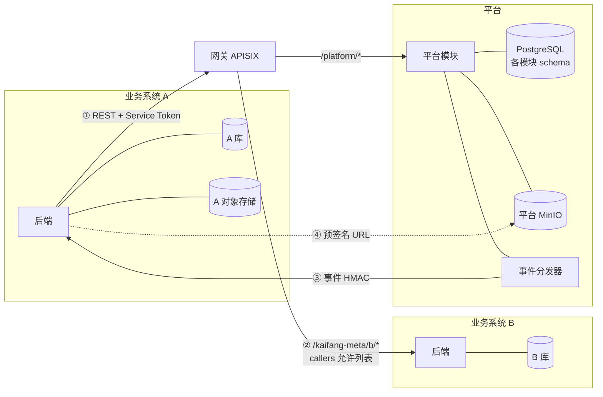

# 多应用设计

> 跨部署段：业务系统 / 内置应用 ↔ 网关 ↔ 平台。相关：[对象存储路径](storage.md)、[应用接入](platform/auth/app-onboarding.md)、[业务与平台通信](communication.md)、[能力目录与下放](platform/capability/catalog.md)、[统一权限组件](platform/auth/authz.md)、[多节点部署](deployment.md)。

## 要点

- **应用 = 平台中登记的一个接入方**：一个 `client_id`、一个网关前缀、一个应用空间 `space.<app>`、一组平台授权与事件订阅。业务系统、平台控制台、桌面端都是应用，平台模块和独立进程不是。
- **应用之间互不直连**：应用 → 平台、应用 → 应用都经网关 REST + Service Token；平台 → 应用只发事件。应用间不共享库、不共享存储、不经平台中转业务事件。
- **数据归属跟着应用走**：每个业务系统自有数据库与对象存储，存业务主数据和原件；平台只存「平台侧」数据（身份、能力配置、调用记录、任务、标注、知识库索引），按模块 schema、按租户隔离。
- **文件跨边界只走预签名 URL**：业务系统永远拿不到平台 MinIO 的密钥，平台也不访问业务存储；平台对象按 `{业务目录}/{tenant_id}/{client_id}/…` 组织，临时对象有保留期。
- **任何跨应用读写都可审计**：调用方 `client_id`、代表的 `sub`、`X-KM-Request-Id` 贯穿网关日志、平台审计与业务日志。

## 应用清单

| 应用 | `client_id` | 类型 | 网关前缀 | 鉴权模式 | 是什么 |
|------|-------------|------|----------|----------|--------|
| 平台控制台 | `kaifang-meta-console` | 内置 web | `/kaifang-meta/console` | 网关托管 | 平台管理、应用空间；标注工作台（由业务系统打开）；随平台部署，没有独立后端 |
| 智慧档案室 | `kaifang-meta-archive-room` | web | `/kaifang-meta/archive` | 网关托管 | 档案导入、著录、检索、问答；核心演示流程的业务方 |
| 文书加工系统 | `kaifang-meta-doc-process` | web | `/kaifang-meta/doc` | 透传自验 | 文书扫描、图像处理、OCR 加工；加工成果交付给智慧档案室 |
| 统建系统 | `kaifang-meta-unified-build` | web | `/kaifang-meta/ub` | 网关托管 | 面向多个单位统一建设的业务系统，开通多个租户 |
| 库房管理 | `kaifang-meta-warehouse` | web | `/kaifang-meta/wh` | 业务自管（过渡） | 库房、库位、出入库与环境管理；存量系统，迁移前只能以应用身份调用平台 |
| Agent 桌面端 | `kaifang-harness` | desktop | `/kaifang-meta/harness` | 用户 Token 直连平台 | 没有业务后端，Agent 在本机运行，用 `space.harness` 的授权直接用模型，知识库经平台知识库 MCP（后续），见 [Agent 桌面端](harness.md) |

每个应用接入后自动拥有：

| 资产 | 存放在 | 说明 |
|------|--------|------|
| 应用描述（OIDC、路由、上游、订阅、授权） | 平台 · 认证模块 | 唯一配置源，下发 APISIX 与事件分发器，见 [应用接入](platform/auth/app-onboarding.md) |
| 密钥 `client_secret` / `gateway_secret` / `event_secret` | 平台存哈希，业务存只读挂载文件 | 双密钥轮换 |
| 应用空间 `space.<app>` | 平台 · 能力 / AI 模块 | 能力点绑定、私有知识库、Agent、流水线、私有算子 |
| 本地用户、组织、角色、菜单、数据权限 | 业务系统自己的库 | 按 `sub` 关联，权限组件同一套实现，见 [统一权限组件](platform/auth/authz.md) |

## 调用与通信



| # | 关系 | 通道 | 身份与准入 | 说明 |
|---|------|------|-----------|------|
| ① | 应用 → 平台 | 网关 `/kaifang-meta/platform/<module>/v1/*`，同步 / `202` 异步 / SSE | Service Token，`scope` 来自 `platform_access`；代表用户时加 Token Exchange 或 `X-KM-On-Behalf-Of` | 详见 [业务与平台通信](communication.md) |
| ② | 应用 → 应用 | 网关 `/kaifang-meta/<target>/*` | 调用方 Service Token；目标应用的 `gateway.callers` 必须包含调用方，否则网关 `403` | 只用同步 REST；目标应用按自身权限决定能返回什么 |
| ③ | 平台 → 应用 | outbox → 事件分发器 → `POST events.endpoint` | `X-KM-Event-Sign` | 只发平台事件（任务完成、绑定变更、账号停用），事件只带标识 |
| ④ | 应用 ↔ 平台文件 | MinIO 预签名 URL（15 分钟） | URL 自带签名，由平台接口签发 | 见下文「文件对象」 |

**应用 → 应用的约定**（以文书加工系统把加工成果交给智慧档案室为例）：

- 目标应用在自己的 OpenAPI 中声明对外接口，路径前缀 `/open/v1/`，与本系统前端接口分开；调用方用 SDK 生成的客户端调用。
- 目标应用在 `gateway.callers` 中登记允许的调用方；网关在模式 A 下注入 `X-KM-Client-Id`，目标应用据此做接口级授权。
- 写接口带 `Idempotency-Key`，由目标应用自己的库存唯一约束（如「加工批次号 + 档号」）。
- 长任务由目标应用自己返回 `202 + id`，调用方轮询；**平台事件分发器不承载业务事件**，避免平台反向理解业务语义。确有大量应用间异步需求时再评审，不预先建设。
- 大文件由提供方从**自己的**对象存储签发预签名下载 URL，接口只传 URL，不经平台 MinIO 中转。
- 应用 C 模式（库房管理）不能作为代表用户的调用方，只能以应用身份调用；被调用时目标应用需自行判定身份。

```http
POST /kaifang-meta/archive/open/v1/batches
Authorization: Bearer <kaifang-meta-doc-process 的 Service Token>
Idempotency-Key: DP-20241026-07
Content-Type: application/json

{ "source": "doc-process", "items": [{ "doc_no": "WS·2024·D30-0012", "file_url": "https://doc.internal/presigned/…" }] }
```

**禁止的通信**：业务系统直连平台节点或其他业务节点（绕过网关）、跨系统读库、共享对象存储桶或密钥、浏览器持有 Service Token、平台调用业务接口。

## 数据存储

### 归属划分

| 数据 | 归属 | 存放 |
|------|------|------|
| 登录账号、凭据、`sub`、会话 | 平台 · 认证 | 平台 PostgreSQL `iam` schema、Redis |
| 应用描述、密钥哈希、审计 | 平台 · 认证 | 平台 PostgreSQL `app` schema |
| 控制台权限 | 平台控制台（认证模块托管） | 平台 PostgreSQL `console_authz` schema |
| 能力目录、能力点绑定、调用记录、计量 | 平台 · 能力 | `capability` schema |
| 知识库定义、版本、文档映射、Agent 快照、会话审计 | 平台 · AI | `ai` schema，按租户隔离 |
| 切片、向量、关键词索引、Agent 运行态 | 平台 · AI 的引擎 WeKnora | 独立数据库 `kaifang-meta-weknora`（pgvector），按 WeKnora 租户隔离，见 [WeKnora](platform/capability/weknora.md) |
| 任务、流水线状态 | 平台 · 任务调度 | `jobs` schema |
| 标注工单、结果版本 | 平台 · 标注 | `annotation` schema |
| 业务主数据（档案、著录、库位、出入库……）、本地用户与权限、事件收件箱 `km_event_inbox` | 各业务系统 | 业务自己的数据库 |
| 原件文件（扫描件、PDF、附件） | 各业务系统 | 业务自己的对象存储 |

- 平台内模块只读写自己的 schema，跨模块走接口；共享部署时表带 `tenant_id`，Repository 注入条件 + RLS 兜底，见 [网关与鉴权](gateway.md)。
- **业务系统的数据库与对象存储不属于平台基础设施**：平台不读写、不备份、不做容量管理。部署上可以与平台共用同一 PostgreSQL / MinIO 集群以节省资源，但必须是**独立的 database / 桶与独立账号**，平台账号无权访问，业务账号也无权访问平台 schema 与桶。
- 平台保存的业务数据只有两类：调用时送来的**处理副本**（待解析文件、送标注数据、知识库文档）和平台**产出的结果**（预抽取结果、标注结果）。业务系统拉回结果后写入自己的库，**以业务库为准**；平台侧副本按保留期清理。
- 知识库文档是长期副本：以 `external_id` 关联业务主键，业务删除或密级变更时由业务推送 delete / upsert，平台不主动回查业务库。

### 文件对象（平台 MinIO）

平台对象统一放在单桶 `kaifang-meta-platform`，按 `{业务目录}/{tenant_id}/{归属}/…` 组织，业务目录登记、保留期与访问规则见 [对象存储路径](storage.md)。
