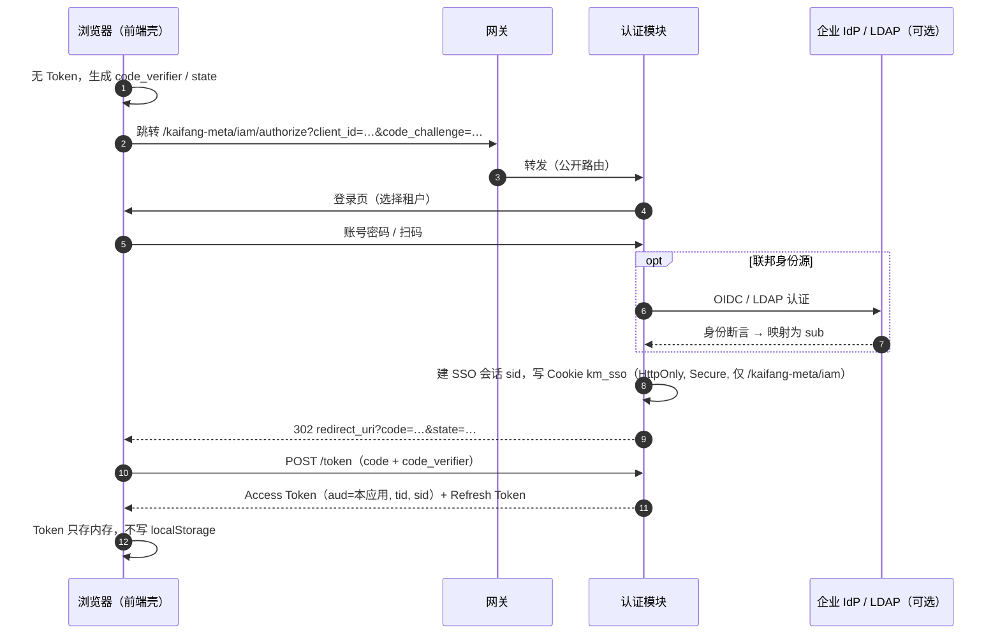
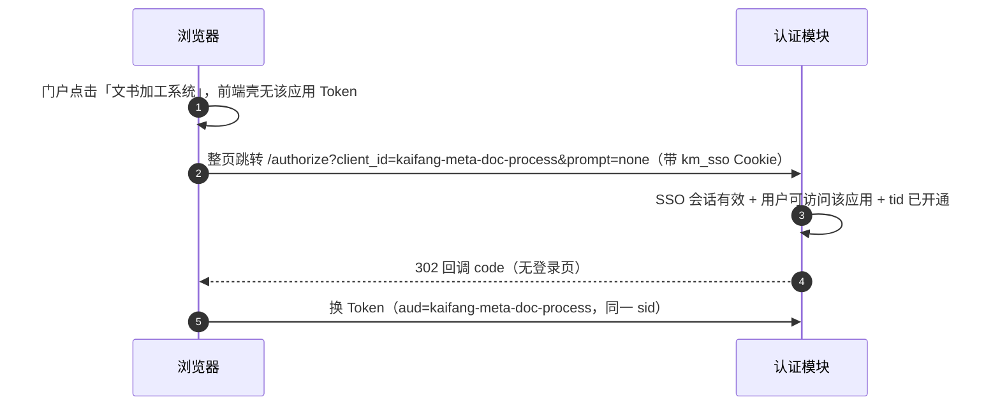
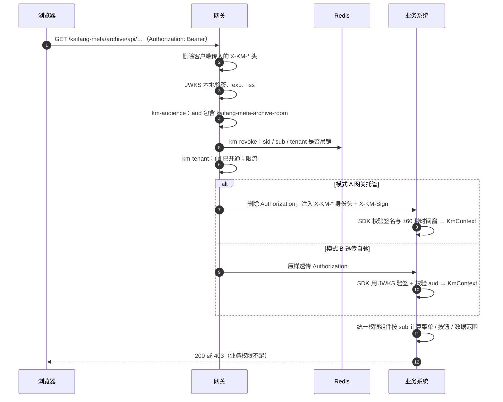
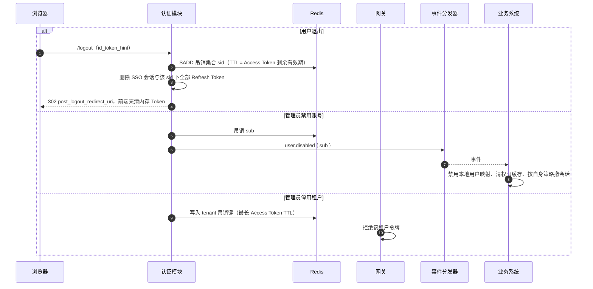
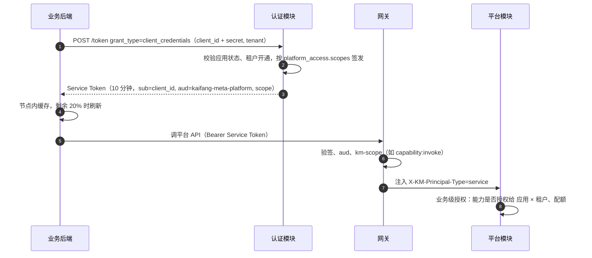

# 鉴权流程

> 跨部署段：前端壳 ↔ 认证模块 ↔ 网关 ↔ 业务 / 平台。Token 结构、身份头、三种鉴权模式的定义见 [网关与鉴权](gateway.md)；本文只描述时序。相关：[统一认证与身份](platform/auth/identity.md)、[应用接入](platform/auth/app-onboarding.md)、[统一权限组件](platform/auth/authz.md)。

## 要点

- **两层鉴权**：网关做身份认证与粗粒度访问控制（Token 有效、`aud`、租户开通、吊销、`scope`）；业务系统做细粒度授权（菜单、按钮、数据范围，统一权限组件按 `sub` 计算）。
- **用户登录**：OIDC 授权码 + PKCE，由前端壳 `kaifang-meta-shell` 完成；认证模块持有 SSO 会话 Cookie，进入其他应用时静默换取该应用的 Token。
- **服务调用**：client credentials 换 Service Token；代表用户时模式 B 用 Token Exchange，模式 A 用 `X-KM-On-Behalf-Of`。
- **退出与禁用**：吊销 `sid` / `sub` / `tenant` 写入 Redis，网关所有节点即时生效；业务系统收 `user.disabled` / `user.enabled` 事件更新本地映射，账号创建、资料变更与删除通过 `user.created` / `user.updated` / `user.deleted` 通知。
- 失败语义固定：身份问题返回 `401`，权限或开通问题返回 `403`，前端壳只对 `401` 触发重新登录。

## 1 首次登录

- 用户属于多个租户时登录页选择租户；一个 Token 只含一个 `tid`，切换租户 = 重新走授权（SSO 会话内免输密码）。
- `client_secret` 只用于业务后端换 Service Token，不进入浏览器。

## 2 SSO 进入另一个应用

- 使用整页跳转而非隐藏 iframe，避免浏览器第三方 Cookie 限制。
- 会话无效时返回 `login_required`，前端壳再走首次登录。

## 3 请求经网关

模式 C（业务自管）跳过身份相关插件，只限流与记日志；业务系统可把平台配置为外部 OIDC IdP，流程同上文第 1 步。

## 4 Token 续期

- 前端壳在 Access Token 剩余 2 分钟时用 Refresh Token 换新；Refresh Token **一次一用、每次轮换**，旧串再次出现视为泄露，吊销整个 `sid`。
- 页面刷新后内存中 Token 丢失，前端壳走第 2 步的 `prompt=none` 静默恢复。
- Refresh Token 滑动续期，SSO 会话最长 8 小时，到期需重新登录。
- 请求返回 `401` 时前端壳先尝试续期并重放一次，仍失败才跳转登录。

## 5 退出与禁用

吊销写 Redis 后网关所有节点下一次请求即拒绝，无需等 Token 过期。租户重新启用时移除租户吊销键，尚未过期的旧令牌会恢复可用。

## 6 服务调用

业务调业务时 `aud` = 目标应用 `client_id`，网关额外校验调用方在目标应用的 `callers` 允许列表中。

## 7 代表用户调用

需要把用户身份带到平台（Agent 会话、知识库检索审计到人）时：

| 鉴权模式 | 方式 | 平台得到的身份 |
|----------|------|---------------|
| B 透传自验 | Token Exchange：`subject_token` = 用户 Token，`actor_token` = Service Token → 新 Token（`aud` = 平台，`act.sub` = 业务 client_id） | 用户 + 调用方 |
| A 网关托管 | Service Token + `X-KM-On-Behalf-Of: `；应用需有 `delegate:user` scope，平台校验 `sub` 在当前租户有效 | 用户 + 调用方 |

- 两种方式下平台的授权都以**应用**为准（能力授权、配额），用户维度只用于审计与数据过滤条件，不会获得超过应用本身的权限。
- `X-KM-On-Behalf-Of` 只在平台 API 路由上被识别；其他路由上网关按 `X-KM-*` 前缀统一删除。

## 8 桌面端

[Agent 桌面端](harness.md) 是公共客户端：系统浏览器 + 本机回环地址回调 + PKCE，Token 存系统凭据库，直接用用户 Token 调平台 API（`azp = kaifang-harness`），平台按「桌面端 × 租户」授权并加用户级配额。

## 9 平台 → 业务

事件与回调不经网关，业务 SDK 校验 `X-KM-Event-Sign`，见 [业务与平台通信](communication.md)。

## 失败语义

| 场景 | 返回 | `code` | 前端壳行为 |
|------|------|--------|-----------|
| 无 Token / 过期 / 验签失败 | 401 | `TOKEN_INVALID` | 续期一次，失败则登录 |
| 会话已吊销 | 401 | `SESSION_REVOKED` | 直接登录 |
| `aud` 不匹配 | 403 | `AUDIENCE_MISMATCH` | 走第 2 步换该应用 Token |
| 租户未开通应用 | 403 | `TENANT_NOT_ENABLED` | 提示联系管理员 |
| Service Token 缺 scope / 调用方不在允许列表 | 403 | `SCOPE_DENIED` / `CALLER_DENIED` | — |
| 网关签名校验失败（模式 A） | 401 | `GATEWAY_SIGN_INVALID` | 告警：可能绕过网关 |
| 业务权限不足 | 403 | 业务自定义 | 业务页面提示 |
