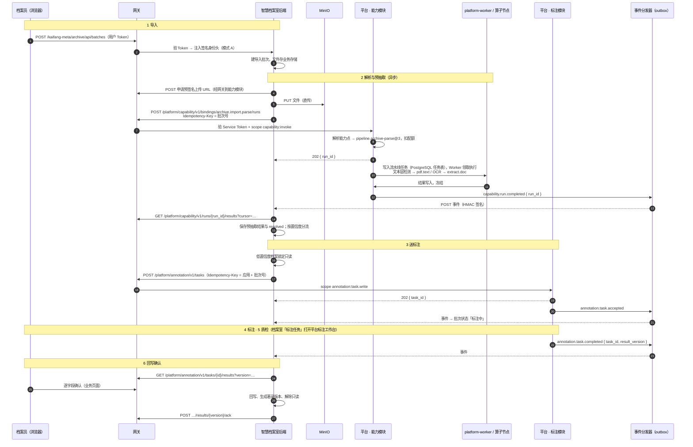
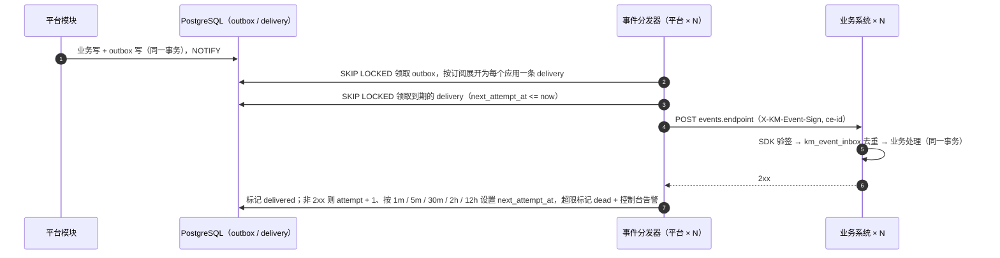

# 业务与平台通信

> 跨部署段：业务系统 ↔ 网关 ↔ 平台。相关：[多应用设计](apps.md)、[网关与鉴权](gateway.md)、[鉴权流程](auth-flow.md)、[多节点部署](deployment.md)、[数据标注](platform/annotation.md)、[能力点](platform/capability/binding.md)。

## 要点

- **方向决定通道**：业务 → 平台一律经网关（REST + Service Token）；平台 → 业务只发事件（PostgreSQL outbox → 事件分发器 → HTTP POST，HMAC 签名），不直接调用业务接口。
- **同步只用于短调用**（≤ 30 秒，如单页 OCR、身份目录查询）；批量、长任务一律异步：`202 + run_id/task_id` → 事件通知 → 业务拉取结果。
- **事件只带标识，不带数据**；事件是加速通道，业务必须有补偿轮询，二者都走 SDK。
- **大文件不走 API**：经 MinIO 预签名 URL 直传，接口只传对象路径。
- **每个写接口都有幂等键**，每个请求都带 `X-KM-Request-Id` 贯穿 trace。
- 浏览器不直接调用平台 API（控制台除外）；业务前端的平台组件经业务后端代理。

## 通信通道

| # | 方向 | 通道 | 身份 | 典型用途 |
|---|------|------|------|---------|
| 1 | 浏览器 → 业务系统 | 网关 `/kaifang-meta/<app>/*` | 用户 Access Token | 业务页面与 API |
| 2 | 浏览器 → 平台控制台 | 网关 `/kaifang-meta/console/*` | 用户 Access Token（`aud = kaifang-meta-console`） | 平台管理；标注工作台（业务页面打开，SSO 静默登录） |
| 3 | 业务后端 → 平台（同步） | 网关 `/kaifang-meta/platform/<module>/v1/*` | Service Token（+ 可选代表用户） | 身份目录、能力同步调用、知识库检索 |
| 4 | 业务后端 → 平台（异步） | 同上，返回 `202` | 同上 | 流水线、批量算子、标注工单 |
| 5 | 业务后端 → 平台（流式） | 同上，SSE | 代表用户 | Agent 会话、问答面板 |
| 6 | 平台 → 业务后端 | outbox → 事件分发器 → `POST events.endpoint` | `X-KM-Event-Sign`（应用 `event_secret`） | 任务完成、绑定变更、身份账号创建 / 修改 / 启停 |
| 7 | 业务后端 ↔ MinIO | 预签名 URL（15 分钟） | URL 自带签名 | 上传待解析文件、下载标注快照 |
| 8 | 业务 → 业务 | 网关 `/kaifang-meta/<target>/*` | Service Token，目标应用 `callers` 允许列表 | 文书加工系统调用智慧档案室 |

## 接口约定

| 项 | 约定 |
|----|------|
| 路径与版本 | `/kaifang-meta/platform/<module>/v1/...`；主版本进路径，兼容变更只加字段 |
| 契约 | 每个模块发布 OpenAPI，SDK 客户端由其生成 |
| 幂等 | 所有 `POST` 写接口支持 `Idempotency-Key`，平台存唯一约束；重复提交返回首次结果，内容不同返回 `409` |
| 异步 | `202 { id, status }` + 事件 `<module>.<object>.<state>` + `GET` 查询状态与分页结果 |
| 错误 | HTTP 状态码 + `{ code, message, request_id, details }`，`code` 形如 `CAPABILITY_QUOTA_EXCEEDED`；`429` / `503` 带 `Retry-After` |
| 超时与重试 | 同步默认 30 秒；SDK 只对幂等请求或带 `Idempotency-Key` 的请求重试（指数退避，最多 2 次） |
| 追踪 | 网关生成 `X-KM-Request-Id` 并写入 W3C `traceparent`；SDK 在调用平台、发事件时透传，事件的 CloudEvents 扩展属性 `traceparent` 同样携带 |
| 租户 | 由 Token 的 `tid` 决定，请求体中不传租户；Service Token 换取时指定租户 |

能力调用接口（能力模块）：

| 接口 | 说明 |
|------|------|
| `POST /capability/v1/bindings/{能力点}/invoke` | 同步调用，返回结果与 `resolved` |
| `POST /capability/v1/bindings/{能力点}/runs` | 异步调用，返回 `202 { run_id }`；完成后发 `capability.run.completed` / `capability.run.failed` |
| `GET /capability/v1/runs/{run_id}` | 查询状态；`GET …/results?cursor=` 分页拉取结果 |

## 端到端流程：导入 → 回写确认

以智慧档案室为例，串起[数据标注](platform/annotation.md)工作流中的六个步骤。

关键点：

- 第 2 步与第 3 步都是异步：业务后端只保存 `run_id` / `task_id` 与批次的对应关系，**不在请求线程里等待**。
- 每次收到事件都去拉取最新状态，而不是相信事件内容；事件乱序或重复都不会出错。
- SDK 补偿轮询：对「解析中」「标注中」的批次每 10 分钟查询一次，事件丢失时流程仍能推进。
- 幂等键链路：解析用「批次号」，送标注用「应用 + 批次号」，回写用「批次号 + 档号 + 结果版本」。

## 事件投递

- 签名：`HMAC-SHA256(event_secret, ce-id + ce-time + body)`，SDK 校验签名与时间窗（±5 分钟），双密钥轮换期两个都试。
- 投递至少一次且失败重试会让旧事件晚到，消费方不按事件到达顺序覆盖状态：把事件当变更通知，按 `subject` 回查当前状态再更新。
- 业务返回 2xx 即视为送达；处理耗时长的业务应先落库再异步处理，避免超时（分发器超时 10 秒）。
- 订阅关系来自[应用接入](platform/auth/app-onboarding.md)的 `events.subscribe`，每个应用独立的 delivery 记录与并发上限，某个应用故障不阻塞其他应用；outbox 与 delivery 按月分区，已送达记录保留 30 天。

## 流式与前端组件

- 业务前端的问答面板、检索框等平台组件请求**本业务后端**，业务后端计算用户过滤条件后代表用户调用平台（SSE 透传），浏览器不持有 Service Token，见 [能力目录](platform/capability/catalog.md)。
- 网关对 SSE 路由关闭响应缓冲（`proxy_buffering off`），读超时放宽到 5 分钟。
