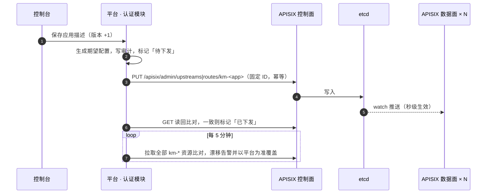

# 网关与鉴权

> 部署段：网关（APISIX × N，开源，不自研）。相关：[统一认证](platform/auth/identity.md)、[应用接入](platform/auth/app-onboarding.md)。

## 要点

- 不引入 Nacos 等注册中心。三段式下上游数量少且稳定。
- 纯 Docker 部署，不使用 K8s：APISIX upstream 配静态节点列表（主机 IP:端口）+ 主动健康检查；节点增减由应用接入配置下发，见 [多节点部署](deployment.md)。
- 网关自身无状态，配置存 etcd，多节点前置 SLB / Keepalived VIP。
- 网关职责：路由、JWT 校验（JWKS）、身份头注入、服务间签名校验、限流熔断、灰度、访问日志。
- 鉴权按应用三选一：**网关托管**（默认，网关验 Token 后注入签名身份头）、**透传自验**（原样透传 Token，业务经 SDK 验签）、**业务自管**（存量系统过渡态，网关只路由）。
- APISIX 控制面 / 数据面分离：平台认证模块经 Admin API 下发路由；运维人员也可通过本地 APISIX Dashboard 直接写入，需知手工改动可能被平台对账覆盖，且不经过平台审计。详见下文「APISIX 集成」。
- 多节点下网关、平台、业务实例都不保存会话；共享状态只放 etcd / Redis / PostgreSQL。详见 [多节点部署](deployment.md)。端到端调用与鉴权时序见 [业务与平台通信](communication.md)、[鉴权流程](auth-flow.md)。


## 设计目标

1. 多个业务系统共用一个网关，但**鉴权方式不能一刀切**：新系统希望“网关验完我就信”，部分系统需要自己验 Token，老系统有自己的登录体系。
2. 网关只做**身份认证与粗粒度访问控制**；业务权限（菜单、按钮、数据范围）仍在业务系统内。
3. 不自研网关、不引入注册中心，所有能力用 APISIX 内置插件 + 少量自定义 Lua 插件实现。

## 三种鉴权模式（按路由配置）

每个应用在接入时选择一种模式，网关按路由前缀 `/kaifang-meta/<app>/*` 应用对应插件组合。

| 模式 | 名称 | 网关做什么 | 业务系统做什么 | 适用 |
|------|------|-----------|---------------|------|
| **A** | 网关托管 `gateway` | 校验 JWT（JWKS）→ 清洗并注入身份头 → 加网关签名 → 转发；**不透传原始 Token** | SDK 校验网关签名，读取身份头 | 新建系统（默认） |
| **B** | 透传自验 `passthrough` | 校验 JWT（可选，建议开启做前置拦截）→ 原样透传 `Authorization` | SDK 用 JWKS 自行验签，读取完整 claims | 需要完整 claims、零信任要求、或会再向下游转发用户 Token 的系统 |
| **C** | 业务自管 `self` | 不校验身份，只做路由、限流、访问日志 | 自有登录与会话；可选通过 OIDC 联邦把平台作为外部 IdP | 存量系统、暂不改造的第三方系统 |

要点：

- **模式 C 是过渡态**。接入时登记“计划迁移时间”，在控制台标黄提示；其用户如需调用平台能力，只能以应用身份（client credentials）调用，不能代表用户。
- 每个应用可额外配置**公开路径白名单**（如 `/callback`、`/health`、`/public/**`），白名单路径在 A/B 模式下也不校验 Token。
- 同一个应用只能选一种模式，避免同一系统内两套身份来源。

## Token 设计

由认证模块签发，非对称签名（ES256 / RS256），JWKS 公布公钥，`kid` 轮换（新旧密钥并存 ≥ 2 个 Token 有效期）。

| Token | 有效期 | 用途 |
|-------|--------|------|
| Access Token（JWT） | 15 分钟 | 用户访问业务系统与平台 API |
| Refresh Token（不透明串） | 8 小时，滑动续期（客户端可覆盖，如桌面端 7 天，见 [Agent 桌面端](harness.md)） | 仅在认证模块换新 Access Token，存 Redis 可吊销 |
| Service Token（JWT） | 10 分钟 | 应用间 / 应用调平台，client credentials 换取 |

Access Token 主要 claims：

```json
{
  "iss": "https://<host>/kaifang-meta/iam",
  "sub": "u_8f21c0",            // 用户 ID（全局唯一，不复用）
  "tid": "t_5e2a9c1d7b3f4086",           // 租户 ID，见下文“轻租户”
  "aud": ["kaifang-meta-archive-room"],  // 目标应用 client_id
  "azp": "kaifang-meta-archive-room",    // 申请 Token 的客户端
  "sid": "s_1a9e…",             // 登录会话 ID，用于吊销
  "scope": "openid profile",
  "exp": 1761500000, "iat": 1761499100, "jti": "…"
}
```

- `sub` 是全局唯一且不复用的身份主键。业务系统用它关联本地用户，不得用姓名或手机号作为关联主键。
- **不放业务组织、权限、角色、菜单**：这些由业务系统维护，放进 Token 会让身份服务反向依赖业务。
- `aud` 必须包含目标应用：网关按路由所属应用校验 `aud`，避免 A 系统的 Token 被拿去访问 B 系统。门户登录后进入某个应用时，由前端壳静默换取该应用的 Token（OIDC `prompt=none`，同一 SSO 会话）。
- **吊销**：退出登录或禁用用户时，将 `sid` / `sub` 写入 Redis 吊销集合；停用租户时写入 `tenant_id` 吊销键，TTL 覆盖最长 Access Token。网关 `km-identity` 查 Redis；租户重新启用时删除租户吊销键，停用期间令牌不可用，尚未过期的旧令牌会恢复可用。

## 身份头与网关签名（模式 A）

网关先**删除**客户端传入的所有 `X-KM-*` 头（防伪造），再注入：

| 头 | 来源 |
|----|------|
| `X-KM-User-Id` | `sub` |
| `X-KM-Tenant-Id` | `tid` |
| `X-KM-Client-Id` | `azp`（用户 Token）或服务 Token 的 `sub` |
| `X-KM-Principal-Type` | `user` / `service` |
| `X-KM-Request-Id` | 网关生成，贯穿 OpenTelemetry trace |
| `X-KM-Ts` | 网关时间戳（毫秒） |
| `X-KM-Sign` | `HMAC-SHA256(app_gateway_secret, method + path + ts + user + tenant + client + on_behalf_of)`，`path` 含查询参数（有参数时为 `/a/b?x=1`，无参数时不带 `?`），`on_behalf_of` 仅平台 API 路由代表用户时有值，否则为空串 |

- `app_gateway_secret` **按应用独立**，接入时生成，只在网关与该应用之间共享，泄露不影响其他应用。
- SDK 校验签名与时间窗（±60 秒），校验失败直接 401。签名 + 网络策略（业务实例只允许网关网段访问）双重保证“请求一定来自网关”。
- 用户姓名、手机号等**不放头**；身份账号基础字段可经 SDK 查身份目录，业务资料与组织信息由业务系统本地维护。

## 服务间调用

| 场景 | 方式 |
|------|------|
| 业务系统 → 平台 API（能力调用、创建标注工单、查身份目录） | client credentials 换 Service Token，经网关；网关按 `scope` 做粗粒度授权，如 `capability:invoke`、`annotation:task.write`、`directory:read` |
| 业务系统 → 业务系统 | 同上，目标应用需在接入配置中**显式授权调用方**（允许列表），否则网关拒绝 |
| 代表用户调用下游（模式 B） | Token Exchange（RFC 8693）：用户 Token 换成 `aud`=下游、`act`=调用方 的新 Token，保留用户身份，便于审计 |
| 代表用户调用下游（模式 A） | 业务后端拿不到原始 Token，改用 Service Token + `X-KM-On-Behalf-Of: <sub>`；需应用具备 `delegate:user` scope，平台校验该 `sub` 在当前租户有效，审计同时记录用户与调用方。权限不超过应用自身 scope，用户维度只用于审计与数据过滤，见 [鉴权流程](auth-flow.md) |
| 平台 → 业务系统（事件投递、标注回调） | 不经网关反向调用业务内网地址；请求带 `X-KM-Event-Sign`（应用事件密钥 HMAC），SDK 验签 |

## 是否需要租户：需要，但做“轻租户”

**结论：从第一天起引入租户维度（`tenant_id`），初始化只有系统租户 `t_system`（即默认租户），业务单位按需新建租户；不做 SaaS 式完整多租户。**

判断依据：

| 问题 | 现状 / 预期 | 对租户的需求 |
|------|------------|-------------|
| 是否会服务多个独立单位（如多个档案馆、区县分馆、外部客户）？ | 很可能（统建系统天然面向多单位） | 需要数据隔离与独立配额 |
| 不同单位的用户能否互相看见？ | 不能 | 组织树不足以表达，需要上层隔离边界 |
| 事后补租户的成本 | 所有表加列、所有查询加条件、历史数据迁移 | 极高；现在加只是一列 + 一个上下文 |

**租户 / 组织 / 应用三者区别**：

- **租户**：中台数据与配置的隔离边界（一个独立单位）。应用开通、能力配额、标注数据、知识库等中台资源归属租户；平台可记录身份用户对租户的访问关系。
- **组织**：各业务系统自己的组织树，用于本系统选人与业务数据范围，不属于平台租户模型，也不是中台隔离边界。
- **应用**：一套部署的业务系统，可被多个租户开通（应用 × 租户 = 开通关系）。

**实现方式**：

- 隔离级别分两档，按客户要求选择：
  - **共享部署（默认）**：共享库表 + `tenant_id` 列；平台各模块的 Repository 层强制注入租户条件，并在 PostgreSQL 上启用 RLS（`SET app.tenant_id`）兜底。MinIO 对象路径为 `{业务目录}/{tenant_id}/…`，见 [对象存储路径](storage.md)。
    - 平台进程以非超级用户 `POSTGRES_APP_USER` 连接（不绕过 RLS），`POSTGRES_USER` 只用于 alembic 迁移；迁移创建该账号并授权现有与后续的表。
    - 控制台请求在一个事务内 `SET LOCAL app.tenant_id = tid`（另设 `app.sub` 供本人记录可见）；策略为「未设置或系统租户不限，否则只见本租户行」。认证流程、worker 不设置，按需跨租户读取。
    - 当前启用 RLS 的表：`iam.account`（主租户或成员租户）、`iam.tenant_member`、`console_authz.role_binding`、`console_authz.auditlog`。
  - **独立部署**：对隔离要求极高的单位单独部署一套平台，`tenant_id` 固定。代码无差异。
- 用户与租户：用户归属一个主租户；跨租户用户（如运维、上级督导）通过成员关系加入其他租户，登录时选择租户，**一个 Token 只含一个 `tid`**，切换租户即重新换 Token。
- 平台超级管理员属于系统租户 `t_system`，可管理所有租户；租户管理员只管本租户。
- **业务系统的租户处理由业务决定**：
  - 只服务一个单位的系统：忽略 `tid`，接入时绑定到一个租户即可；
  - 多单位系统：业务表加 `tenant_id`，SDK 提供 `TenantContext` 与 MyBatis / JPA / SQLAlchemy 过滤插件自动注入条件。
- 网关校验“Token 的 `tid` 是否开通了该应用”（开通关系缓存在网关插件），未开通返回 403。

## 网关插件链（模式 A 示例）

```
请求 → real-ip → request-id → km-strip-headers → cors
     → openid-connect(bearer_only, JWKS) / jwt 校验
     → km-audience（校验 aud 与路由所属应用）
     → km-revoke（sid / sub / tenant 吊销检查）
     → km-tenant（租户是否开通该应用）
     → km-scope（仅平台 API 路由：按 scope 粗粒度授权）
     → limit-count（按 应用×租户 限流）→ api-breaker
     → km-identity（注入 X-KM-* 头 + 签名，删除 Authorization）
     → traffic-split（灰度）→ upstream
```

`km-*` 为自研 Lua 插件，均很小（各数十行），随网关镜像发布。

## APISIX 集成

### 部署拓扑

| 组件 | 形态 | 说明 |
|------|------|------|
| 入口 | SLB 或 Keepalived VIP | 对外 443，TLS 可在 SLB 或 APISIX 终结（二选一，内网默认在 APISIX） |
| 数据面 | APISIX × N（≥ 2），`deployment.role: data_plane` | 只处理流量，不开放 Admin API；镜像 `kaifang-meta-gateway` = 官方 3.x LTS 镜像 + `km-*` 插件 |
| 控制面 | APISIX × 2，`deployment.role: control_plane` | 只开放 Admin API（9180），仅允许平台所在网段访问；Admin Key 只由认证模块持有 |
| 配置存储 | etcd × 3（独立集群，Docker 部署在三台主机） | 数据面 watch etcd 热更新，无需重启 |

- **APISIX Dashboard**：本地开发使用 APISIX 3.13+ 内嵌 `/ui/`，Admin API 与 UI 仅绑定本机；控制台允许手工写入，但写操作不经过平台审计，平台应用描述仍是持久配置来源，对账可能覆盖手工改动。生产 Admin API / UI 只允许运维网段访问。
- `km-*` 插件以 Lua 文件打进镜像（`extra_lua_path` + `config.yaml` 的 `plugins` 列表），随镜像版本发布；插件变更 = 发新镜像 + 滚动重启数据面。
- `app_gateway_secret`、`client_secret` 等敏感字段写入 etcd 前经 APISIX `data_encryption`（keyring）加密，etcd 备份泄露不直接暴露密钥。

### 资源映射：应用描述 → APISIX

认证模块把[应用描述](platform/auth/app-onboarding.md)翻译为 APISIX 资源，资源 ID 固定（`km-<app>`、`km-<app>-public`），重复下发幂等。

| 应用描述字段 | APISIX 资源 | 说明 |
|-------------|-------------|------|
| `gateway.upstream` | `upstream/km-<app>` | 静态 `nodes`（主机 IP:端口，带权重）+ `checks.active`；发布时把节点权重置 0 摘流 |
| `auth.mode` | `plugin_config/km-auth-{gateway,passthrough,self}` | 三套插件模板，路由用 `plugin_config_id` 引用，模板升级一处生效 |
| `gateway.prefix` | `route/km-<app>`（`uri: /kaifang-meta/<app>/*`） | 路由级覆盖：`km-audience.aud`、`km-identity.secret`、限流阈值 |
| `auth.public_paths` | `route/km-<app>-public` | 更高 `priority`，不挂鉴权插件，只挂限流与日志 |
| `tenants` | `km-tenant.tenants`（路由内） | 开通关系随路由下发，数据面无需查库 |
| `gateway.callers` | `km-audience.callers`（路由内） | 业务间调用的允许列表 |
| `gateway.rate_limit` | `limit-count`（`policy: redis-cluster`） | 多节点共享计数，见 [多节点部署](deployment.md) |
| 全局 | `global_rules` + `plugin_metadata` | real-ip、request-id、km-strip-headers、访问日志；JWKS 地址、吊销 Redis 地址 |

### 平台自身的路由

平台也按普通应用接入（模式 A），平台进程用同一套 SDK 校验网关签名。

| 前缀 | 上游 | 鉴权 |
|------|------|------|
| `/kaifang-meta/iam/*` | 平台 | 公开（OIDC 端点自身做客户端认证），单独限流防撞库 |
| `/kaifang-meta/console/*` | 平台（控制台前端 + API） | 模式 A，`aud = kaifang-meta-console` |
| `/kaifang-meta/platform/<module>/v1/*` | 平台 | 模式 A，接受用户 Token 与 Service Token，`km-scope` 校验 `scope` |
| `/kaifang-meta/<app>/*` | 业务系统 | 按应用配置的模式 |
| `/kaifang-meta/harness/*` | 平台（桌面端下载主页与安装包跳转） | 公开（默认），可按租户改为需登录 |
| `…/platform/iam/v1/clients/*/releases/latest` | 平台 | 公开，单独限流（客户端未登录也要能检查更新） |

### 下发与对账



- 下发失败不回滚平台配置，保持「待下发」并指数退避重试，控制台显示状态。
- 平台不认识的非 `km-*` 资源只告警不删除，留给运维排查。
