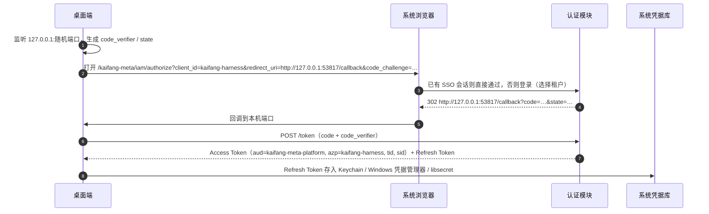
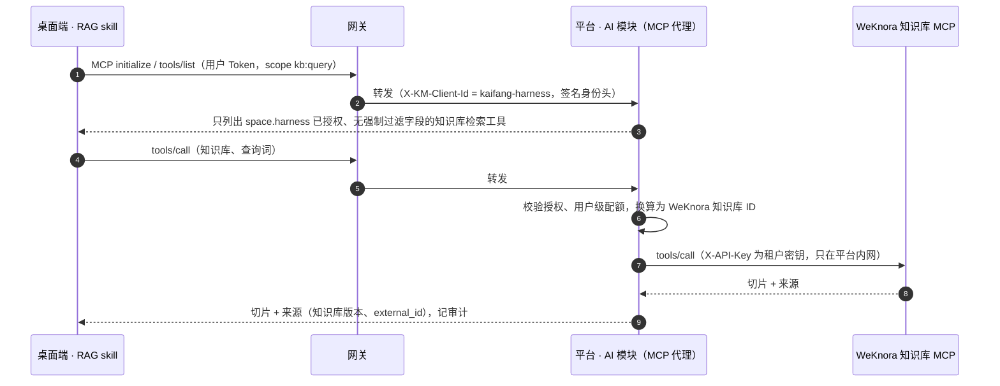
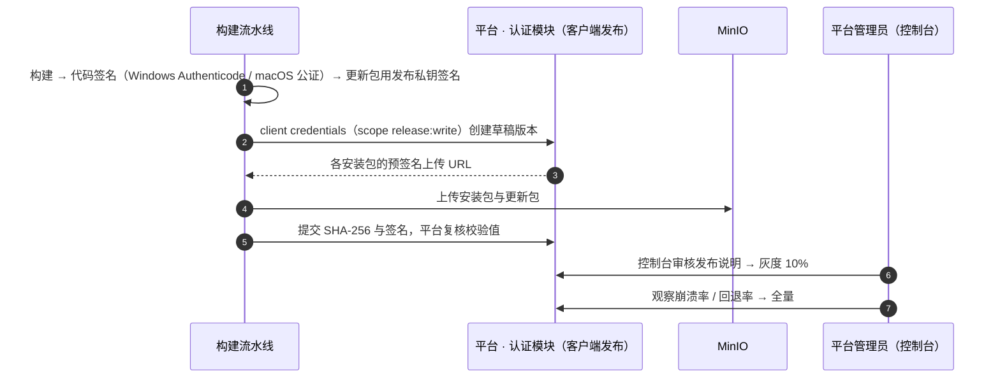

# Agent 桌面端 kaifang-harness

> 配套客户端，项目名 `kaifang-harness`（Windows / macOS / Linux），也是其 `client_id` 与安装包名。命名是 `kaifang-meta-*` 约定的例外：它是独立产品，不是中台部件。基于 DeepSeek harness 开发，Agent 在本机运行；在平台中登记为一个 `desktop` 类型的应用，没有自己的业务后端，直接经网关调用平台。相关：[鉴权流程](auth-flow.md)、[应用接入](platform/auth/app-onboarding.md)、[能力目录](platform/capability/catalog.md)、[网关与鉴权](gateway.md)。

## 要点

- **统一认证**：OIDC 授权码 + PKCE，打开系统浏览器登录，经本机回环地址回调（RFC 8252）；公共客户端，不内置 `client_secret`。Token 存操作系统凭据库，不写明文文件。
- **桌面端与服务端 Agent 分开**：桌面端的 Agent 继续由 DeepSeek harness 在本机编排；平台业务 Agent 由 AI 模块的 DeepSeek Harness Runtime 首版运行。两者会话、工具权限和发布版本独立，桌面端不复用业务系统本地用户会话。
- **知识库经 MCP（后续）**：后续开发的 RAG skill 通过平台知识库 MCP 检索 WeKnora 知识库；MCP 由 AI 模块代理 WeKnora 的知识库 MCP，桌面端不直连 WeKnora，见 [WeKnora](platform/capability/weknora.md)。
- **授权与配额**：桌面端拥有自己的应用空间 `space.harness`，模型、知识库按「应用 × 租户」授权给桌面端，另加**用户级配额**；平台按用户 Token 审计到人。
- **数据边界**：桌面端没有业务后端，无法计算业务权限过滤条件，因此**只能使用未声明强制过滤字段的知识库**（制度、规范、公共知识）；带业务 ACL 的档案知识库仍只能经业务系统后端使用。
- **版本发布与更新**：在平台控制台「客户端发布」维护版本、渠道、灰度与最低支持版本；安装包存 MinIO，经签名校验后自动更新。
- **下载主页**：平台托管公开页面 `/kaifang-meta/harness/`，按操作系统推荐安装包，展示版本说明与校验值。
- 发布管理归属认证模块的应用接入（客户端是应用的一种），不新增平台模块。

## 应用登记

```yaml
app: harness
client_id: kaifang-harness
name: Agent 桌面端
type: desktop                   # 公共客户端：无 client_secret、无 gateway_secret、无事件订阅
tenants: [t_5e2a9c1d7b3f4086]

oidc:
  redirect_uris: [http://127.0.0.1/callback]   # 回环地址，端口任意（RFC 8252）
  grant_types: [authorization_code, refresh_token]
  pkce: required
  session: { refresh_ttl: 7d, max_ttl: 30d }    # 覆盖默认 8 小时，桌面端免频繁登录

platform_access:                # 用户 Token 的 scope 上限
  scopes: [model:invoke, kb:query]      # kb:query 供后续 RAG skill 使用知识库 MCP
  bindings: [harness.chat]
  user_quota: { tokens_daily: 200000 }

release:
  channels: [stable, beta]
  platforms: [windows-x64, macos-arm64, macos-x64, linux-x64]
  homepage: /kaifang-meta/harness/
```

## 认证流程



- 使用系统浏览器而不是内嵌 WebView：可复用浏览器里已有的 SSO 会话，也避免客户端接触用户密码。
- Refresh Token 一次一用、每次轮换，绑定设备标识；管理员可在控制台账号详情中吊销某台设备的会话（吊销其 `sid`），用户也可在桌面端「退出所有设备」。
- 启动时用 Refresh Token 静默换 Access Token；失败（过期、吊销、账号停用）则重新打开浏览器登录。
- 切换租户 = 重新授权换取新 `tid` 的 Token，与 Web 端一致。

## 调用平台能力

| 用途 | 接口 | 说明 |
|------|------|------|
| 对话 | `POST /kaifang-meta/platform/capability/v1/bindings/harness.chat/invoke`（SSE） | 能力点绑定到模型（如 `llm.chat@1`），换模型不需要发新版 |
| 知识库检索（后续，RAG skill） | `POST /kaifang-meta/platform/ai/v1/mcp`（MCP Streamable HTTP） | AI 模块代理 WeKnora 知识库 MCP；工具列表只含已授权给桌面端、且无强制过滤字段的知识库 |

本机 Agent 的编排、工具调用、技能（skill）仍在桌面端完成；平台 AI 模块还提供面向业务系统的服务端 Agent 会话，见 [AI 模块：Agent 管理与运行](platform/ai/overview.md)。桌面端不会因此变成服务端 Agent 的调用入口。

**RAG skill 调用知识库 MCP**：



- 桌面端不持有 WeKnora API Key，也不知道 WeKnora 地址；WeKnora MCP 的其他工具（增删文档、管理知识库）不透传。
- 检索结果由本机 Agent 拼进提示词，再经 `harness.chat` 调用模型；密级路由仍由模型网关处理。

- 网关按平台 API 路由走模式 A：校验用户 Token、`aud`、`km-scope`；平台得到 `X-KM-Client-Id = kaifang-harness`、`X-KM-Principal-Type = user`。
- 平台授权：能力是否授权给「桌面端 × 租户」→ 应用 × 租户配额 → **用户级配额**（桌面端没有业务后端汇聚流量，按 `sub` 限额防止单人耗尽配额）。
- **密级**：用户把本地文件交给 Agent 时，桌面端按租户策略标注密级（默认按最高未知处理），模型网关据此路由到本地部署模型；高密级内容不发往外部模型。
- 会话记录默认存在本机；平台只保存调用审计（谁、何时、用了哪个能力与版本、Token 量），不保存会话正文。如需云端同步会话，作为后续功能另行设计。
- 平台对低于最低支持版本的客户端返回 `426 Upgrade Required`（按请求头 `X-KM-Client-Version`），桌面端随即进入强制更新。

## 版本发布与更新

### 数据模型

| 对象 | 字段 |
|------|------|
| 版本 `Release` | 版本号（语义化）、渠道（stable / beta）、发布说明、最低支持版本、灰度比例、状态 |
| 安装包 `Artifact` | 平台（如 `windows-x64`）、类型（安装包 / 增量更新包）、MinIO 路径、大小、SHA-256、更新签名 |

版本状态：`草稿 → 灰度 → 全量 → 已撤回`。撤回后不再分发；若撤回原因为安全问题，把最低支持版本提到修复版本，旧客户端强制更新。

### 发布流程



- 发布私钥只在构建流水线中，平台与客户端只持有公钥；客户端安装更新前同时校验 SHA-256 与签名，平台被攻破也无法推送伪造更新。
- 灰度按 `hash(设备标识) % 100 < 灰度比例` 判定，同一台设备结果稳定；可按租户指定渠道（如试点单位走 beta）。

### 更新检查

`GET /kaifang-meta/platform/iam/v1/clients/kaifang-harness/releases/latest?platform=windows-x64&channel=stable&current=1.4.2&device=<设备标识哈希>`

| 返回 | 含义 |
|------|------|
| `204` | 已是最新 |
| `200 { version, notes, url, size, sha256, signature, mandatory }` | 有更新；`mandatory = true` 表示当前版本低于最低支持版本，必须更新后才能继续使用 |

- 接口公开（只限流），未登录也能检查更新，保证过旧客户端能升级；带 Token 时按其租户匹配渠道。
- 客户端启动时及每 6 小时检查一次；非强制更新在后台下载，下次启动时安装。

## 下载主页

| 路由 | 内容 |
|------|------|
| `/kaifang-meta/harness/` | 产品介绍；识别访问者操作系统，主按钮下载对应安装包；其他平台安装包；系统要求与安装说明 |
| `/kaifang-meta/harness/releases` | 版本历史与发布说明，每个安装包的大小与 SHA-256 |
| `/kaifang-meta/harness/download/{version}/{platform}` | 302 到 MinIO 预签名 URL（5 分钟有效），并记下载计数；`latest` 表示当前渠道最新全量版本 |

- 页面由平台根据发布数据渲染，发布新版本即自动更新，不需要单独维护官网。
- 默认在内网公开；租户可配置「下载需登录」，此时下载链接要求用户 Token。
- 内网隔离环境同样适用：安装包存平台 MinIO，不依赖外网 CDN。
