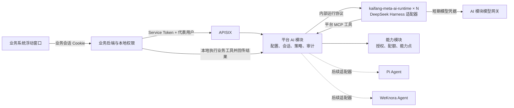
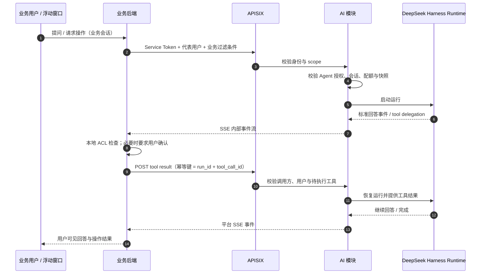

# AI 模块：Agent 管理与运行

> 平台 · AI 模块。相关：[能力目录](../capability/catalog.md)、[知识库与 Agent 版本](../capability/knowledge-agent.md)、[业务与平台通信](../../communication.md)、[统一认证与身份](../auth/identity.md)、[Agent 桌面端](../../harness.md)。

## 要点

- AI 模块是 Agent 的控制面与运行入口；首版通过独立 Node 运行进程服务化 DeepSeek Harness，后续用同一运行时契约接入 Pi Agent 或 WeKnora Agent。
- Agent、提示词、Skill、MCP 工具、模型与知识库的版本和授权由平台管理；具体 Agent 循环与引擎会话由运行时适配器负责。
- 浏览器浮动窗口由业务系统的 `kaifang-meta-shell` 提供；业务后端代理会话请求、映射 `sub`、计算业务权限，并在本地执行本系统的工具。
- Agent 发布为依赖锁定的不可变快照；`prod` 只指向一个已发布版本，切换运行时也必须发布新版本。
- 模型密钥、业务 Service Token、WeKnora Key 不进入浏览器或 Agent 引擎；运行时只拿到短期、限范围的调用凭据。
- Agent 执行不允许平台主动回调业务系统；业务写操作由调用方业务后端完成并复核用户权限。

## 模块边界

AI 是平台模块，不新增一套应用后端。控制台管理 API、对外 AI API、版本和会话数据归 AI 模块及 `ai` schema；能力模块仍负责能力目录、应用空间授权、能力点绑定、配额和公共计量。模块间只走接口，不读取对方 schema。



`kaifang-meta-ai-runtime` 是 AI 模块的 Node.js 执行进程，不对网关或浏览器开放，只接受 AI 模块的内部请求。它不新增数据库、队列或向量库；运行会话持久化在 AI 模块自己的 `ai` schema。WeKnora 继续承担知识库索引与检索，并作为后续 Agent Runtime Provider 候选；桌面版 `kaifang-harness` 保持本机编排，不复用服务端会话。

## Agent Runtime 抽象层

### 设计目标

控制台和调用方只依赖平台 Agent 契约，不依赖 DeepSeek Harness 的 Session、Cordis 插件或 ACP 类型。AI 模块负责把通用 Agent 快照编译为运行计划；适配器负责创建引擎会话、翻译事件、暂停和恢复工具调用、取消运行。

```text
Agent API → AI Run Orchestrator → AgentRuntimeProvider
                                  ├─ DeepSeekHarnessProvider（首版）
                                  ├─ PiAgentProvider（后续）
                                  └─ WeKnoraAgentProvider（后续）
```

### 适配器契约

所有实现遵循同一内部接口；`run_id`、`conversation_id` 和平台事件由 AI 模块生成，不能使用引擎会话 ID 作为公开 ID。

```typescript
interface AgentRuntimeProvider {
  id: string
  capabilities(): RuntimeCapabilities
  validate(snapshot: AgentSnapshot): ValidationIssue[]
  startRun(request: RuntimeRunRequest): AsyncIterable<RuntimeEvent>
  continueRun(request: RuntimeContinuation): AsyncIterable<RuntimeEvent>
  cancelRun(runId: string): Promise<void>
  health(): Promise<RuntimeHealth>
}
```

| 契约 | 平台语义 | 适配器工作 |
|---|---|---|
| `capabilities` | 引擎支持的流式输出、工具调用、恢复、引用、结构化输出、人工确认等能力 | 报告真实能力和限制，不伪造支持项 |
| `validate` | Agent 发布前检查快照是否满足引擎要求 | 返回字段级错误；不兼容依赖不得发布 |
| `startRun` | 开始一轮新的 Agent 执行并返回标准事件流 | 把通用消息、模型、工具与知识上下文转换成引擎请求 |
| `continueRun` | 接收业务工具结果、用户确认或补充输入后恢复执行 | 将平台 continuation 映射到引擎的恢复 / 工具结果接口 |
| `cancelRun` | 用户停止、超时或账号被禁用时停止当前运行 | 取消模型请求和在途工具调用，释放引擎资源 |
| `health` | 运行时节点就绪与容量状态 | 返回运行状态、支持的适配器版本和并发上限 |

`AgentSnapshot` 只包含跨引擎稳定的配置：Agent 标识和版本、模型能力别名、精确提示词版本、Skill 版本、知识库版本、MCP 工具版本、上下文与安全策略。`RuntimeRunRequest` 包含平台会话 ID、当前用户 `sub`、应用和租户、已校验的业务上下文引用、消息与附件引用。引擎专有参数只能放在带适配器命名空间的扩展字段中，不能进入通用 UI 或平台 API。

### 标准事件

适配器把引擎事件映射为以下平台事件，业务前端只渲染平台事件，不依赖某个引擎的事件名称。

| 事件 | 用途 |
|---|---|
| `run.started` / `run.done` / `run.error` | 一轮执行状态与标准错误码 |
| `assistant.delta` / `assistant.message` | 流式回答与完整消息 |
| `citation` | 知识库、文档、页码和片段来源 |
| `tool.started` / `tool.completed` | 工具执行状态与经过脱敏的摘要 |
| `tool.approval.required` | 需要用户确认的业务操作；前端确认后经业务后端回传 |
| `tool.delegation.required` | 需要调用方业务系统本地执行的工具请求，不透传给浏览器 |
| `usage` | 模型 token、运行时长与资源用量 |

不向普通用户暴露引擎内部推理轨迹；只展示检索来源、工具名称、执行状态和可审计的操作摘要。未知事件映射为兼容性错误并记录 adapter 诊断信息，不能静默丢弃写操作结果。

### 首版 DeepSeek Harness 适配

- 运行进程采用最小插件组合：Agent loop、模型网关客户端、AI 模块 MCP 客户端、标准事件映射和会话持久化；不加载 shell、文件系统、任意 Web、子 Agent 等 coding-agent 工具。上游 Harness 是插件式结构，工具与子 Agent 属于独立能力包，服务端应显式选择最小组合，见 [上游包结构](https://github.com/deepseek-ai/deepseek-harness/blob/master/packages/README.md)。
- 所有模型请求经平台模型网关；运行进程拿短期、仅限模型别名与本次运行的凭据，不拿模型服务商 API Key。
- 所有工具调用经过 AI `ToolBroker`。平台内置工具在 AI 模块内执行；业务工具变成等待调用方执行的 `tool.delegation.required`，由业务后端按当前用户的本地权限执行后回传结果。
- AI 模块持有标准会话消息和事件日志；Harness Session ID 仅作为内部运行时映射。运行时重启后按规范化消息和工具事件恢复；无法恢复时返回可重试错误，不从其他 Agent 版本接管会话。
- 上游 Harness 的 ACP 可用于适配器内部验证或进程间驱动；不直接作为平台 API。当前上游 ACP 以 JSON-RPC stdio 自动化服务形式提供，支持持久会话、MCP Server、模型选项、语义事件、权限确认和取消；因此 HTTP / SSE、身份映射和平台事件归一仍由 AI 模块适配层负责，见 [上游 ACP 说明](https://github.com/deepseek-ai/deepseek-harness/blob/master/packages/acp/README.md)。

运行时提供商的能力在发布时校验。首版至少支持流式文本、MCP 工具调用、取消、工具暂停 / 恢复和模型计量；若某个引擎不支持 Agent 所需的功能，发布失败而不是在运行时降级成无权限或无确认的执行。

## 管理对象与生命周期

| 对象 | 关键字段与职责 | 版本规则 |
|---|---|---|
| 模型部署与别名 | 服务商、内网端点、服务商密钥引用、模型能力（chat / embedding / rerank）、上下文限制、密级和配额策略 | 配置修订可审计；Agent 锁定模型别名及解析到的配置修订 |
| 提示词模板 | 名称、模板正文、变量 JSON Schema、适用场景、可见空间 | 草稿编辑；每次发布生成不可变版本和内容哈希 |
| Skill | 声明式任务说明、输入输出 Schema、引用的提示词 / 知识库 / 工具 | 版本不可变；Skill 本身不授予工具权限，不执行任意代码 |
| MCP 服务与工具 | 服务来源、传输类型、认证引用、工具名称、参数 Schema、风险等级和调用范围 | 工具列表变化生成修订；发布 Agent 时锁定工具 Schema 与版本 |
| 知识库 | 文档、切片、向量模型、ACL 强制字段与检索策略 | 沿用[知识库快照规则](../capability/knowledge-agent.md) |
| Agent | 资源组合、运行时、输入输出 Schema、权限策略、调试和评测结果 | 草稿 → 校验 / 评测 → 发布快照；`prod` 可回滚 |

### 提示词模板

- 模板正文只允许受控变量替换；变量必须有类型、必填规则和长度限制，不执行模板代码。
- Agent 运行时的消息层级固定为：平台安全规则 → 应用策略 → Skill 指令 → Agent 提示词 → 检索上下文 → 用户消息。来自用户、知识库和工具的内容始终是非可信数据，不能覆盖平台规则。
- 版本详情展示 diff、变量 Schema、依赖 Agent、评测结果和发布记录。编辑已发布版本只能“另存为草稿”。

### Skills 与 MCP 工具

- 内置 Skill 首版只提供声明式能力，例如“依据知识库回答并引用来源”“检索档案并汇总”。它们组合提示词、输入 Schema 和允许资源，不含脚本执行器。
- 内置 MCP 提供知识库检索等平台工具。工具只按 Agent 快照中登记的 allowlist 暴露，不把 WeKnora 管理工具转发给 Agent。
- 业务系统通过受控管理 API 提交工具名、用途、输入 Schema、风险等级和所需业务权限；工具执行仍留在业务后端。平台不任意连接用户提交的 URL，也不把业务 Service Token 注入 Harness。
- 工具参数在调用前按 JSON Schema 校验；只读工具可直接运行，写入 / 删除等副作用操作要求用户确认，并由业务后端再次检查用户权限和数据范围。

### Agent 发布

1. 创建草稿并选择 AI 模块注册的运行时、已授权模型、提示词、Skills、知识库和 MCP 工具。
2. AI 模块解析所有别名，校验应用空间授权、依赖版本和运行时能力，生成只读依赖清单。
3. 运行测试对话和评测集；检查知识库 ACL、工具入参与确认流程。写操作在测试环境使用沙箱数据或模拟执行器。
4. 发布为不可变版本，并在能力模块登记 `agent` 能力。应用授权后可绑定能力点或由业务后端请求 Agent 清单。
5. 将 `prod` 指向新版本；回滚只切换别名。活跃会话继续使用启动时锁定的版本，新会话使用新 `prod`。

## 业务用户、浮动窗口与工具执行

### 身份与权限

业务系统继续维护本地用户资料、角色、菜单和数据权限。业务登录态不复制进 AI 模块；业务后端把本地用户映射到平台全局 `sub`，通过 Service Token + `X-KM-On-Behalf-Of` 或 Token Exchange 调用 AI API。AI 审计以 `(client_id, tid, sub)` 记录身份，并由能力模块检查应用 × 租户授权和配额。

每次调用还可携带业务后端计算的 `business_context`，例如可见全宗、记录范围或当前业务对象。该字段只接受带 `delegate:user` 权限的已登记应用后端请求；浏览器不能提交或修改它。AI 不解释业务角色；业务工具在执行时用 `sub` 再做本地权限检查。知识库声明强制过滤字段时，缺少过滤条件直接拒绝。

### 浮动窗口

- `kaifang-meta-shell` 提供可嵌入的浮动按钮与对话抽屉；业务系统传入当前页面对象引用和场景标识，不传 Service Token。
- 用户点击后，组件向本业务后端请求可用 Agent 列表；后端依据本地角色过滤，平台再检查应用空间授权。`@` 自动完成只展示双重授权后可用的 Agent。
- 用户发送问题后，浏览器请求本业务后端；后端代理 SSE 到 AI API，注入 `sub`、业务过滤条件和页面允许访问的对象引用。浏览器只拿到用户可见事件。
- 新开会话、查看历史、取消运行均通过业务后端代理；会话按 `tid + client_id + sub` 做归属校验。

### 业务操作的反向工具回传

平台部署约定是平台不主动调用业务接口，因此 Agent 不能持有业务系统的广泛凭据，也不能让 AI 模块直接连接业务 MCP 地址。业务工具采用调用方执行模式：



工具回传必须匹配原 `run_id`、`tool_call_id`、应用、租户和 `sub`，有短有效期且只能提交一次。业务后端不在 SSE 事件中转发敏感参数或 Service Token；对用户要求确认的操作，未经确认不得执行。平台侧 `tool.delegation.required` 是服务端协议事件，不发送到浏览器。

## 数据归属与 API

核心配置和会话表均属于 `ai` schema：`model_endpoint`、`prompt_template/revision`、`skill/revision`、`mcp_server/tool_revision`、`agent/agent_version/dependency`、`conversation/message/run/run_event/tool_approval`。实体带 `tenant_id` 与 `space_id`；Agent 定义可在空间开通租户间共享，会话、消息、运行和计量按租户隔离。用户只以 `sub` 字符串关联，不跨模块建外键。

Agent 运行事件与会话历史按应用保留策略清理。审计记录只保留定位问题所需的资源版本、调用者、工具摘要、错误码和用量；默认不把完整提示词、模型密钥或业务工具结果写入普通日志。

| API | 用途 |
|---|---|
| `GET /kaifang-meta/platform/ai/v1/agents/available` | 服务端获取当前应用与租户已授权 Agent；业务后端再按本地权限裁剪 |
| `POST /kaifang-meta/platform/ai/v1/agents/{agent}/conversations` | 创建会话，锁定 `prod` 解析到的 Agent 版本；支持 `Idempotency-Key` |
| `POST /kaifang-meta/platform/ai/v1/agents/{agent}/conversations/{conversation}/runs` | 启动一轮运行并返回标准 SSE；幂等键由调用方 turn ID 生成，重试返回原 run |
| `POST /kaifang-meta/platform/ai/v1/runs/{run}/tool-results` | 业务后端回传本地工具结果；`Idempotency-Key = run_id + tool_call_id` |
| `POST /kaifang-meta/platform/ai/v1/runs/{run}/approvals` | 回传用户确认 / 拒绝；同一审批只接受一次 |
| `DELETE /kaifang-meta/platform/ai/v1/runs/{run}` | 取消运行 |

提示词、Skill、MCP、模型、知识库和 Agent 的管理 API 也在 `/platform/ai/v1/` 下；发布 Agent 时 AI 模块通过能力模块接口登记能力与依赖，不跨 schema 读写。

## 控制台页面

- **Agent**：列表显示应用空间、运行时、`prod` 版本、模型、知识库、工具数、评测结果和调用量。详情页采用“配置 / 调试 / 版本”三栏；配置分为模型与运行时、提示词、Skills、知识库、MCP 工具、权限策略。
- **提示词 / Skills / MCP 工具**：各自提供列表、版本详情和引用关系；Agent 编辑页只选择资源，不复制粘贴已管理的工具配置。
- **运行时**：平台管理员查看适配器版本、支持能力、健康、并发和错误率；应用空间管理员不能更改运行进程和服务商密钥。
- **调用记录**：按 Agent 版本、应用、租户、`sub`、状态和时间查询；工具明细展示风险等级、执行主体、确认结果和脱敏摘要。

## 实施顺序

1. 定义平台 Agent API、事件 Schema、AI schema 与能力模块授权接口。
2. 用 DeepSeek Harness 建立最小 Node runtime，完成模型网关、规范化事件、MCP 工具和持久会话适配；禁用 coding-agent 本地执行能力。
3. 完成模型、提示词、Skill、MCP、知识库引用和 Agent 草稿 / 发布 / 回滚管理。
4. 实现业务后端工具回传 SDK 与 `kaifang-meta-shell` 浮动窗口，先接只读工具，再开放确认式写工具。
5. 用评测集验证多租户隔离、用户 ACL、运行时重启恢复、取消、超时和工具幂等后再开放生产发布。
6. 接入 Pi Agent 或 WeKnora 时只新增 Provider Adapter 和能力映射；如需新平台事件或业务权限语义，再提升平台通用契约，不为新引擎复制 Agent 管理数据。

## 首版验证项

- DeepSeek Harness ACP / SDK 的会话存储能否由 AI `ai` schema 持久化，并在节点重启后恢复；不能恢复时采用规范化消息重建并明确限制。
- 引擎能否暂停一次工具调用，跨 HTTP 请求接收工具结果或用户确认后继续同一轮执行。
- MCP 工具连接、SSE 事件翻译、取消与模型网关短期凭据是否能在不加载 shell / filesystem 插件的最小组合中工作。
- 业务工具调用回传时，业务后端能否可靠映射 `sub` 并在写入前执行本地授权；如需长时间挂起，应限制单会话并发和等待时长。
