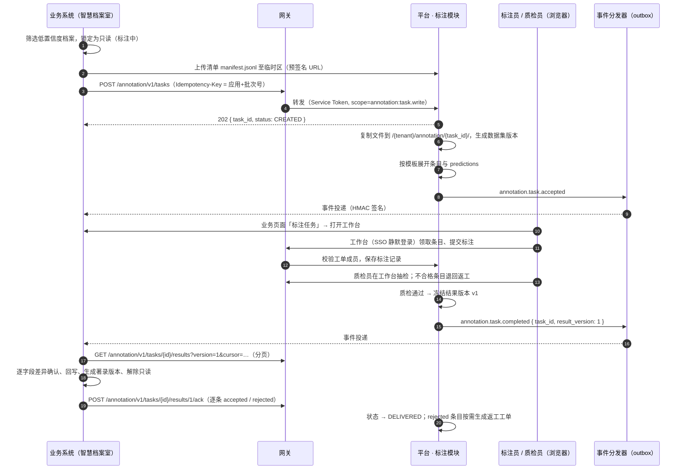
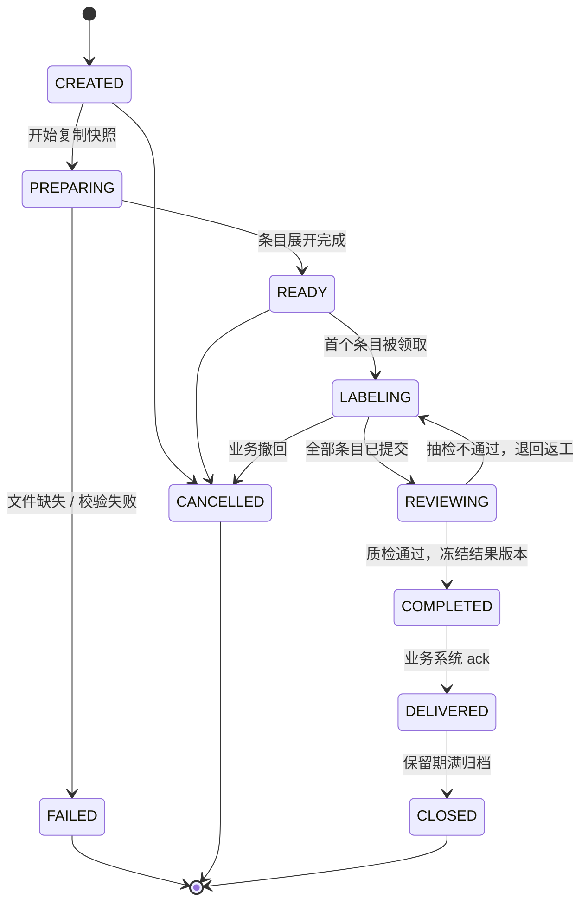

# 数据标注

> 平台 · 数据标注模块。标注画布嵌入开源 Label Studio 编辑器组件，工单、分配、质检、存储、回传由本模块实现；入口在业务系统。相关：[业务与平台通信](../communication.md)、[统一权限组件](auth/authz.md)。

## 要点

- **不自研画布，也不整站对接**：只嵌入 Label Studio 的前端编辑器组件（LSF，Apache-2.0），不部署 Label Studio 服务及其数据库；标注结果直接存本模块 `annotation` schema。
- **覆盖四类标注**：图像（框 / 多边形 / 关键点）、文本分类与实体、实体关系、音视频（分段 / 转写 / 逐帧跟踪），均由模板（编辑器 XML 配置）组合，标签名直接用中文。
- **中文工作台自建**：任务列表、领取、提交、退回、问题件等外壳由平台控制台前端实现；编辑器只承担画布，其余少量英文文案在嵌入层做中文映射。
- **入口在业务系统**：业务页面「送标注 / 标注任务」打开平台托管的标注工作台（同域经网关，新标签或 iframe），SSO 静默登录，工作台只显示该工单。
- **谁标、谁检由业务决定**：工单携带 `members`（`sub` + 标注员 / 质检员），工作台按名单授权；平台控制台只保留模板管理与全局监控。
- **编辑器可替换**：模块内部只认自己的结果格式，编辑器适配集中在工作台一处；某一模态需要换用其他组件（如 LabelU）时只改这一处。

## 选型

| 方案 | 结论 | 理由 |
|------|------|------|
| 从零自研 | 不采用 | 四类模态的画布工作量最大，且与业务无关 |
| 整站对接 Label Studio | 不采用 | 无官方中文；社区版无分配与审核；多一套 Django 服务与数据库；业务逻辑易依赖其内部表 |
| LabelU | 备选 | 原生中文、组件可嵌入；文本实体关系较弱、社区较小，适合按模态替换 |
| **嵌入 Label Studio 编辑器** | **采用** | 模态与模板最全；工作流、存储、界面外壳全部自控，二开集中在本模块 |

```
业务系统 ──工单──▶ 平台 · 标注模块（工单 / 条目 / 分配 / 质检 / 结果版本，annotation schema）
   │                          ▲
   └─打开工作台─▶ 标注工作台（控制台前端，中文外壳）── 嵌入 ── Label Studio 编辑器（画布）
```

编辑器接收「模板 + 条目数据 + predictions」，提交时输出标注 JSON，由工作台调用本模块接口保存。

## 入口与工作台

| 位置 | 内容 |
|------|------|
| 业务系统 | 送标注（选模板、范围、成员、质检策略）、标注任务列表、问题件待办、回写确认 |
| 标注工作台 | 平台托管页面 `/kaifang-meta/console/annotation/workbench/{task_id}`，无控制台菜单，只有本工单的标注 / 质检视图 |
| 平台控制台 | 标注模板、全租户工单监控、事件投递与死信；平台自有数据（如训练集）也在此建单并指定成员 |

- 登录：工作台属于内置应用 `kaifang-meta-console`，用户已在业务系统登录，打开时经 IAM SSO 静默换取控制台 Token（`aud = kaifang-meta-console`）。同域，iframe 无第三方 Cookie 问题。
- 授权：工作台不要求控制台角色，标注模块按「`sub` 是否为本工单成员及其角色」判断能否标注、质检。
- 业务前端只需打开链接，SDK 提供 `annotationUrl(taskId)`。

## 导入 → 标注 → 回写工作流（以智慧档案室为例）

| 步骤 | 系统 | 要点 |
|------|------|------|
| 1 导入 | 智慧档案室 | 上传双层 PDF / OFD，生成导入批次 |
| 2 解析与预抽取 | 智慧档案室 → 中台能力 | 有文本层直接提取（`pdf.text` / `ofd.parse`），无文本层或乱码页才走 OCR；`extract.doc` 预抽取著录项 |
| 3 送标注 | 智慧档案室 → 中台 | 按置信度分流，只送低于阈值的档案；数据以只读快照（数据集版本）发送，档案著录项锁定只读 |
| 4 标注 | 智慧档案室入口 → 中台 · 标注工作台 | 预抽取结果作为 predictions 带入，标注员只确认或修改 |
| 5 质检回传 | 中台 · 标注工作台 | 抽检，不通过退回；通过后发 `annotation.task.completed` 事件，结果可回流训练集 |
| 6 回写确认 | 智慧档案室 | 按批次拉取结果，逐字段差异确认后回写，生成著录版本可撤销，解除只读 |

幂等键为“批次号 + 档号”；标注期间档案只读，因此回写不会产生冲突。回写确认后的档案才推送到全文知识库；知识库问答评测集也以标注工单产出，见 [WeKnora](capability/weknora.md)。


## 核心对象

| 对象 | 归属 | 说明 |
|------|------|------|
| 标注工单 `AnnotationTask` | 平台 · 标注模块 | 业务系统发起的一次标注请求，对应一个业务批次 |
| 数据集版本 `DatasetVersion` | 平台 · 标注模块 | 工单创建时生成的**不可变快照**：文件副本 + 预标注 + 元数据 |
| 标注条目 `Item` | 平台 | 快照中的一条数据，以 `item_key`（如档号）标识 |
| 标注记录 `Annotation` | 平台 | 编辑器输出的标注 JSON，按条目、提交人、轮次保存，返工保留历史 |
| 结果版本 `ResultVersion` | 平台 | 质检通过后冻结的一版结果；返工后再通过生成 v2 |
| 工单成员 `TaskMember` | 平台 | `sub` + 角色（`annotator` / `reviewer`），由发起方指定，工作台据此授权 |
| 标注模板 `Template` | 平台 | 编辑器 XML 配置 + 字段映射（标注 JSON → 结果字段），带版本，如 `archive.ws-item@4` |

职责划分：编辑器组件只做**标注画布**；数据、分配、质检抽检、返工、状态机、回传均由平台标注模块实现，不依赖任何外部标注服务。

## 端到端时序



## 工单状态机



条目级状态：`PENDING → LABELED → (REJECTED → LABELED) → ACCEPTED`，以及 `FLAGGED`（问题件：图像缺页、无法辨认等，需要业务处理）。

## 接口

所有接口挂在 `/kaifang-meta/platform/annotation/v1`，以下省略前缀。

**创建工单**

```http
POST /tasks
Idempotency-Key: kaifang-meta-archive-room:IMP-20241026-03
```

```json
{
  "external_ref": { "app": "kaifang-meta-archive-room", "batch_no": "IMP-20241026-03" },
  "template": "archive.ws-item@4",
  "manifest": "annotation/t_5e2a9c1d7b3f4086/kaifang-meta-archive-room/staging/IMP-20241026-03/manifest.jsonl",
  "item_count": 74,
  "members": [
    { "sub": "u_3301", "role": "annotator" },
    { "sub": "u_3303", "role": "annotator" },
    { "sub": "u_8f21c0", "role": "reviewer" }
  ],
  "qa_policy": { "sample_rate": 0.2, "pass_rate": 0.98 },
  "priority": "normal",
  "deadline": "2024-10-30T18:00:00+08:00",
  "allow_training": true,
  "labels": { "fonds": "J001", "year": "2024" }
}
```

`manifest.jsonl` 每行一个条目：

```json
{"item_key": "J001-2024-WS30-0012", "files": ["…/0012.pdf"], "pages": [1,2],
 "predictions": {"title": {"value": "关于…的通知", "score": 0.71}, "doc_no": {"value": "…", "score": 0.93}},
 "meta": {"source_version": 3}}
```

- 清单走对象存储而非请求体，支持上万条目，路径见 [对象存储路径](../storage.md)；平台校验文件存在性与 `item_key` 唯一性。
- **幂等**：同一 `Idempotency-Key` 重复提交返回同一 `task_id`；内容不一致返回 409。
- `members` 至少一名标注员；未指定质检员时由标注员互检。成员 `sub` 须属于本租户，否则返回 422。

**其他接口**

| 方法 | 路径 | 说明 |
|------|------|------|
| `GET` | `/tasks/{id}` | 状态、进度（已标 / 已检 / 退回 / 问题件计数） |
| `POST` | `/tasks/{id}:cancel` | 撤回；已完成条目的结果仍可拉取 |
| `PUT` | `/tasks/{id}/members` | 调整成员（换人、加人）；已领取未提交的条目释放回待标注 |
| `GET` | `/tasks/{id}/results?version=&cursor=&limit=` | 分页拉取结果版本 |
| `POST` | `/tasks/{id}/results/{ver}/ack` | 回执：逐条 accepted / rejected + 原因 |
| `GET` | `/tasks/{id}/items?status=FLAGGED` | 查询问题件 |
| `POST` | `/tasks/{id}/items/{key}:resolve` | 业务处理问题件后（补图 / 跳过）通知平台 |

以上为业务后端接口（Service Token）。标注工作台另有面向浏览器的接口（用户 Token，校验工单成员）：领取条目、保存标注、提交质检、退回、标记问题件，只供工作台使用，不对业务开放。

**结果条目格式**（字段级差异，业务直接用于回写确认页）：

```json
{
  "item_key": "J001-2024-WS30-0012",
  "status": "ACCEPTED",
  "fields": {
    "title":  { "prediction": "关于…的通知", "final": "关于…的通知（修订）", "changed": true },
    "doc_no": { "prediction": "…", "final": "…", "changed": false }
  },
  "annotator": "u_3301", "reviewer": "u_3302", "reviewed": true,
  "resolved": { "binding_version": 12, "operator": "extract.doc", "version": "1.6.2" }
}
```

## 事件

CloudEvents 1.0，`source = /kaifang-meta/annotation`，`subject = task_id`。事件**只携带标识，不携带结果数据**，业务收到后自行拉取（避免大消息和重复投递导致的重复写入）。

| 事件 | 时机 | 业务通常动作 |
|------|------|-------------|
| `annotation.task.accepted` | 快照与导入完成 | 批次状态改为“标注中” |
| `annotation.task.failed` | 准备失败 | 解锁档案，提示原因 |
| `annotation.item.flagged` | 出现问题件 | 进入业务待办 |
| `annotation.task.progress` | 每 10% 或每 10 分钟最多一次 | 刷新批次进度（可不订阅） |
| `annotation.task.completed` | 结果版本冻结 | 进入“回写确认” |
| `annotation.task.cancelled` | 撤回完成 | 解锁档案 |

投递：平台事件分发器从 PostgreSQL outbox 领取，HTTP POST 到应用的事件地址；失败按 1 分钟 / 5 分钟 / 30 分钟 / 2 小时 / 12 小时退避，最终进入死信并在控制台告警。**业务系统必须同时具备补偿轮询**（SDK 内置：对“标注中”的批次每 10 分钟查询一次状态），事件只是加速，不是唯一通道。

## 一致性与边界

- **只读锁在业务侧**：送标注时锁定，`DELIVERED` 回写完成、`CANCELLED`、`FAILED` 时解锁。锁带超时（默认 = deadline + 3 天），超时进入业务待办而非自动解锁，避免静默丢结果。
- **回写幂等键**：`批次号 + 档号 + 结果版本`。重复拉取、重复回写不会产生重复著录版本。
- **部分拒收**：业务 ack 中 rejected 的条目，平台可一键生成**返工工单**（`parent_task_id` 关联），沿用同一数据集版本，产生新结果版本。
- **快照不可变**：文件在创建工单时复制到平台存储，业务后续修改原件不影响标注；快照保留期按租户配置（默认 180 天），过期删除文件、保留结果与审计。
- **训练回流**：仅当 `allow_training = true` 且条目 `ACCEPTED`，结果才进入训练数据集版本；涉密级别的数据在模板中禁止回流。
- **权限**：标注员、质检员不是平台控制台角色，而是工单成员，由发起方（业务系统，或平台自有数据的控制台建单人）指定；成员必须属于本租户。平台控制台只有标注管理权限点（`annotation:view`、`annotation:manage`），见 [统一权限组件](auth/authz.md)。
