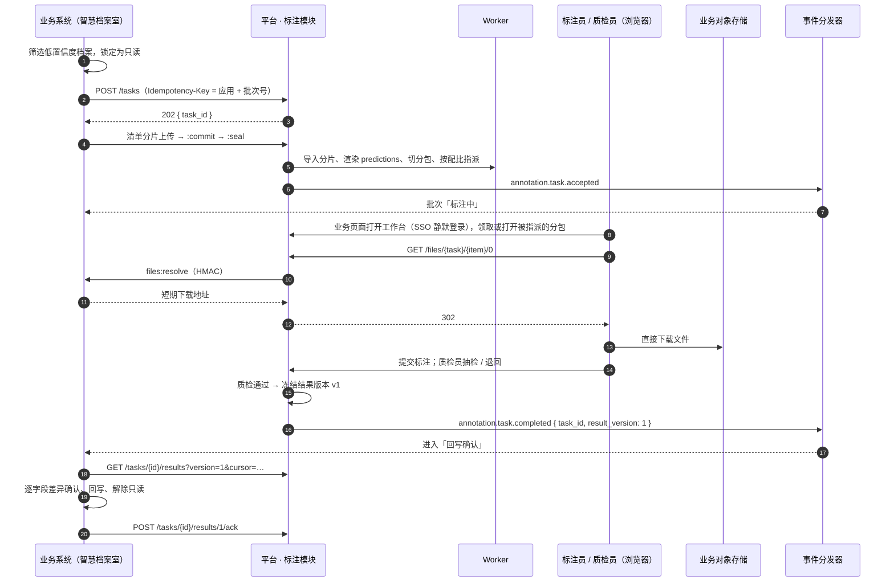

# 业务系统对接

> 平台 · 数据标注模块 ↔ 业务系统。业务如何嵌入标注页面、送海量数据、接收通知、查状态与取结果。相关：[数据标注](overview.md)、[业务与平台通信](../../communication.md)、[应用接入](../auth/app-onboarding.md)、[对象存储路径](../../storage.md)。

## 要点

- **嵌入只有一个链接**：工作台、工单看板、结果查看器都是平台托管页面，业务以新标签或 iframe 打开，SSO 静默登录，iframe 经 `postMessage` 回报事件。
- **海量文件不搬家**：默认引用模式，清单只登记业务文件引用与哈希；标注员打开条目时平台向业务换取短期下载地址并 302，文件从业务存储直达浏览器。
- **清单分片追加**：每片 ≤ 5 万行，首片导入完成即可开标，单工单可到百万条目。
- **通知靠事件，结果靠拉取**：事件只带标识，业务收到后分页拉取或导出整版结果，逐条 `ack`；SDK 每 10 分钟补偿轮询。
- **状态随时可查**：工单进度、条目状态、问题件、分包与处理人都有查询接口，也可直接嵌入工单看板。

## 页面嵌入

| 页面 | 地址 | 谁用 |
|------|------|------|
| 标注工作台 | `/kaifang-meta/console/annotation/workbench/{task_id}` | 标注员、质检员：领取 / 指定的分包、标注、质检 |
| 工单看板 | `/kaifang-meta/console/annotation/tasks/{task_id}` | 业务负责人（`owner` / `viewer`）：进度、分包与处理人、改派、问题件、结果版本 |
| 结果查看器 | `/kaifang-meta/console/annotation/viewer/{task_id}/{item_key}` | 业务任意用户：只读查看某条目的最终标注，适合嵌在业务详情页 |

- 三个页面属于内置应用 `kaifang-meta-console`，无控制台菜单；用户已在业务系统登录，打开时经 IAM SSO 静默换取控制台 Token；语言按 [平台语言设置](labelstudio.md#平台级语言控制)。
- 工作台与看板按工单成员授权，不要求控制台角色；结果查看器另允许业务用 Service Token 签发一次性票据（5 分钟），把查看权交给非成员。
- iframe 嵌入的来源须在应用描述 `annotation.embed_origins` 登记，平台据此输出 `Content-Security-Policy: frame-ancestors`；未登记来源只能新标签打开。

### iframe 消息

工作台向父页面 `postMessage`（`targetOrigin` 为登记来源），只用于刷新业务界面，业务状态以事件和查询接口为准：

```json
{ "type": "km.annotation.ready", "task_id": "at_7c1e", "height": 860 }
{ "type": "km.annotation.item.submitted", "task_id": "at_7c1e", "item_key": "J001-2024-WS30-0012" }
{ "type": "km.annotation.package.finished", "task_id": "at_7c1e", "package": 3 }
{ "type": "km.annotation.close", "task_id": "at_7c1e" }
```

### SDK

| 包 | 能力 |
|----|------|
| Java `kaifang-meta-spring-boot-starter`（`KmAnnotation`） | 建单、清单分片上传、指派、查询、拉取结果、ack；`@KmEventListener("annotation.*")`；`annotationUrl(taskId, view)`；文件签发接口 `KmAnnotationFileResolver` 默认实现 |
| 前端 `@kaifang-meta/sdk` | `openAnnotation(taskId, { mode: 'tab' \| 'iframe', view: 'workbench' \| 'board' \| 'viewer' })`，处理 iframe 高度与消息 |

## 海量数据接入

### 两种文件模式

| | 引用模式 `ref`（默认） | 副本模式 `copy` |
|---|---|---|
| 清单内容 | 业务文件引用 + `sha256` + 大小 | 平台预签名上传后的对象路径 |
| 文件存放 | 业务自己的对象存储 | 平台 `annotation/…/tasks/{task_id}/files/` |
| 浏览器取文件 | 平台向业务换取短期地址，302 | 平台签发 MinIO 预签名地址，302 |
| 适用 | 海量图片、大 PDF、视频；原件在标注期不变（如档案只读） | 原件会变、业务存储浏览器不可达、平台要长期留存；自由标注上传 |
| 不可变保证 | 换取地址时校验哈希，不一致条目转 `FLAGGED` | 复制时计算哈希 |

引用模式遵守「平台不读写业务存储」：平台不持有业务存储凭据，只调用业务的**文件签发接口**：

```http
POST https://archive.internal/kaifang-meta/annotation/files:resolve
X-KM-Event-Sign: t=1730000000,v1=…
Content-Type: application/json

{ "task_id": "at_7c1e", "refs": ["archive-files/t_5e2a/IMP-20241026-03/0012.pdf"], "ttl": 900 }
```

```json
{ "items": [ { "ref": "archive-files/t_5e2a/IMP-20241026-03/0012.pdf",
               "url": "https://minio.archive.internal/archive-files/…?X-Amz-Signature=…",
               "sha256": "9f2c…", "expires_in": 900 } ] }
```

- 签发接口地址登记在应用描述 `annotation.file_resolver`，请求用应用事件密钥 HMAC 签名（与事件投递同一机制）。
- 平台按 `ref` 在 Redis 缓存地址到过期前 1 分钟；工作台预取下一份条目时批量换取。
- 业务存储须对标注员浏览器可达，并对控制台来源开放 CORS（视频、音频、PDF 需支持 `Range`）。

### 文件访问

编辑器里的地址统一是平台地址，结果中也只保存它：

```http
GET /kaifang-meta/platform/annotation/v1/files/{task_id}/{item_key}/{index}
→ 302 Location: <业务或 MinIO 的短期地址>
```

平台校验当前用户是工单成员后才跳转，文件流量不经过平台节点。

### 清单分片

```http
POST /tasks/{id}/manifest-parts                     → { "part_no": 1, "upload_url": "…" }
PUT  <upload_url>                                    （业务直传 jsonl / jsonl.gz）
POST /tasks/{id}/manifest-parts/{part_no}:commit     → Worker 异步导入
POST /tasks/{id}:seal                                （封板，分配标注之后不再追加）
```

清单每行一个条目，`assignee` 可选（指定处理人）：

```json
{"item_key": "J001-2024-WS30-0012",
 "data": {"pages": [{"ref": "archive-files/t_5e2a/IMP-20241026-03/0012.pdf", "sha256": "9f2c…", "size": 4813021, "mime": "application/pdf"}]},
 "predictions": {"title": {"value": "关于…的通知", "score": 0.71}, "doc_no": {"value": "…", "score": 0.93}},
 "assignee": "u_3301",
 "meta": {"source_version": 3}}
```

- 导入在 `bulk` 队列执行：按模板 `data_schema` 校验、`item_key` 去重（已领取的条目拒绝覆盖）、渲染 predictions；错误逐行记录，不影响其他行。
- 首个分片导入完成即 `READY`，可开始领取；≤ 1000 条可在建单请求直接带 `manifest` 路径，视为单分片并自动封板。

### 预处理

| 文件 | 处理 | 存放 |
|------|------|------|
| PDF / OFD | 按页渲染为图像（150 DPI WebP），分包被领取时才渲染该包；有文本层时同时提取文本 | `…/tasks/{task_id}/pages/{item_key}/` |
| 超大图像（边长 > 8000 px） | 生成预览瓦片 | `…/tiles/` |
| 视频 / 音频 | 非 H.264 或非 `faststart` 时转码；生成关键帧索引、波形缓存 | `…/media/` |

预处理调用能力模块算子（如 `pdf.render`、`media.transcode`），由 [任务调度](../scheduler.md) 执行；派生文件随工单保留期清理。

## 接口

业务后端接口挂在 `/kaifang-meta/platform/annotation/v1`（Service Token，scope `annotation:task.write`），以下省略前缀。

**创建工单**

```http
POST /tasks
Idempotency-Key: kaifang-meta-archive-room:IMP-20241026-03
```

```json
{
  "external_ref": { "app": "kaifang-meta-archive-room", "batch_no": "IMP-20241026-03" },
  "mode": "assigned",
  "template": "archive.ws-item@4",
  "template_params": { "secret_levels": ["公开", "内部"] },
  "file_mode": "ref",
  "members": [
    { "sub": "u_3301", "role": "annotator" },
    { "sub": "u_3303", "role": "annotator" },
    { "sub": "u_8f21c0", "role": "reviewer" },
    { "sub": "u_1002", "role": "owner" }
  ],
  "dispatch": { "type": "mixed", "assignees": [{ "sub": "u_3301", "weight": 2 }], "pool": true },
  "package_size": 50,
  "qa_policy": { "sample_rate": 0.2, "pass_rate": 0.98, "double_annotate_rate": 0 },
  "deliver_mode": "whole",
  "deadline": "2024-10-30T18:00:00+08:00",
  "allow_training": true,
  "labels": { "fonds": "J001", "year": "2024" }
}
```

返回 `202 { "task_id": "at_7c1e", "status": "CREATED" }`。同一 `Idempotency-Key` 返回同一 `task_id`，内容不一致 409；成员 `sub` 必须是本租户平台身份账号，至少一名标注员，否则 422。`mode: free` 时忽略 `dispatch`、`package_size`，`qa_policy` 可省略。

| 方法 | 路径 | 说明 |
|------|------|------|
| `POST` | `/tasks/{id}/manifest-parts`、`…/{part}:commit`、`/tasks/{id}:seal` | 清单分片 |
| `GET` | `/tasks/{id}` | 状态与进度（总数、已标、已检、退回、问题件、预标注采纳率） |
| `GET` | `/tasks?app=&status=&batch_no=` | 查询本应用工单 |
| `GET` | `/tasks/{id}/items?status=&assignee=&cursor=` | 条目状态（含问题件、处理人） |
| `GET` | `/tasks/{id}/packages?status=` | 分包、处理人、租约 |
| `POST` | `/tasks/{id}/packages/{no}:assign` | 指派 / 改派分包 `{ "sub": "u_3303" }`；`sub` 为空则放回任务池 |
| `POST` | `/tasks/{id}/items/{key}:resolve` | 问题件处理结果（补文件 / 跳过） |
| `PUT` | `/tasks/{id}/members` | 调整成员 |
| `POST` | `/tasks/{id}:cancel` | 撤回；已冻结结果仍可拉取 |
| `GET` | `/tasks/{id}/results?version=&cursor=&limit=` | 分页拉取结果（≤ 1000 条 / 页） |
| `POST` | `/tasks/{id}/results/{ver}:export` | 异步导出整版结果 jsonl.gz |
| `POST` | `/tasks/{id}/results/{ver}/ack` | 回执：逐条 accepted / rejected + 原因 |
| `POST` | `/tasks/{id}:rework` | 以 rejected 条目生成返工工单 |
| `POST` | `/viewer-tickets` | 签发结果查看器一次性票据 |

工作台另有面向浏览器的接口（用户 Token，校验工单成员）：领取分包、取条目、保存草稿、提交、跳过、标记问题件、质检通过 / 退回、自由标注上传与完成，只供平台页面使用。

**结果条目**

```json
{
  "item_key": "J001-2024-WS30-0012",
  "status": "ACCEPTED",
  "fields": {
    "title":  { "prediction": "关于…的通知", "final": "关于…的通知（修订）", "changed": true },
    "doc_no": { "prediction": "…", "final": "…", "changed": false }
  },
  "raw": null,
  "annotator": "u_3301", "reviewer": "u_8f21c0", "reviewed": true,
  "template": "archive.ws-item@4",
  "resolved": { "binding_version": 12, "operator": "extract.doc", "version": "1.6.2" }
}
```

图像框、实体、分段类模板 `fields` 为空，`raw` 为 Label Studio 结果 JSON（坐标为原图百分比）。

## 事件

CloudEvents 1.0，`source = /kaifang-meta/annotation`，`subject = task_id`，只带标识与计数。

| 事件 | 时机 | 业务通常动作 |
|------|------|-------------|
| `annotation.task.accepted` | 首个分片导入完成 | 批次状态改为「标注中」 |
| `annotation.manifest.part.failed` | 分片有校验错误 | 修正后补传 |
| `annotation.task.failed` | 准备失败 | 解锁数据 |
| `annotation.item.flagged` | 出现问题件 | 进入业务待办 |
| `annotation.task.progress` | 每 10% 或每 10 分钟最多一次 | 刷新进度（可不订阅） |
| `annotation.package.accepted` | `partial` 模式下分包质检通过 | 增量拉取回写 |
| `annotation.task.completed` | 结果版本冻结 | 进入「回写确认」 |
| `annotation.result.exported` | 导出文件就绪 | 下载整版结果 |
| `annotation.task.cancelled` | 撤回完成 | 解锁数据 |

事件分发器从 outbox 领取，POST 到应用事件地址并带 `X-KM-Event-Sign`；失败按 1 分钟 / 5 分钟 / 30 分钟 / 2 小时 / 12 小时退避，最终进死信并告警。**业务必须同时有补偿轮询**（SDK 内置）。

`deliver_mode: partial` 时每个分包质检通过即追加进当前结果版本并发 `annotation.package.accepted`，适合超大工单边标边回写；默认 `whole` 全部通过后一次冻结。

## 端到端时序（智慧档案室）



回写确认后的档案才推送全文知识库，见 [WeKnora](../capability/weknora.md)。
