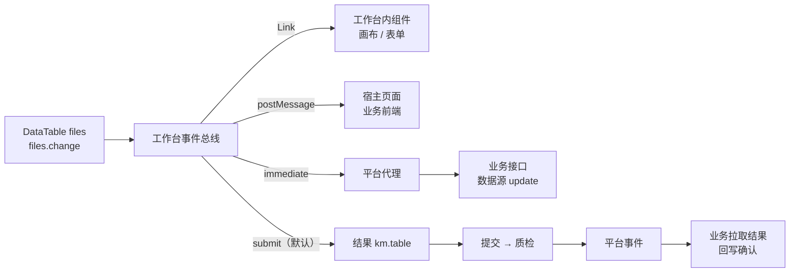
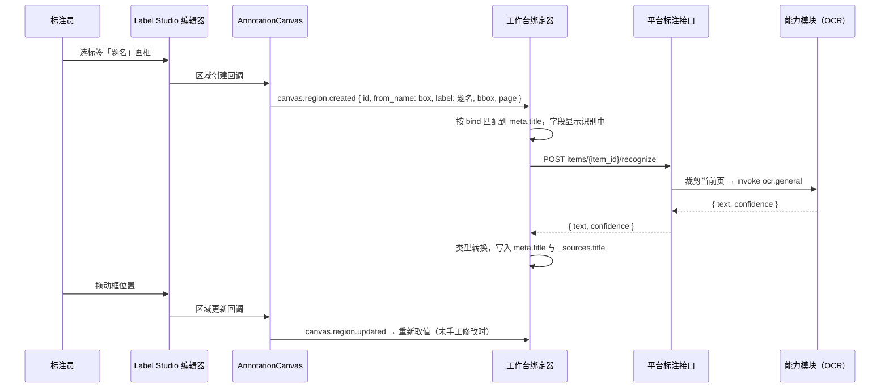

# 组件事件与框选回填

> 平台 · 数据标注模块 · 标注工作台。表格修改如何通知其他组件、宿主页面与业务系统，Label Studio 控件（矩形框、画笔标签等）如何回填表单与表格。相关：[工作台布局与插件 · 组件联动](layout.md#组件联动)、[表单](components/form.md)、[数据表格](components/data-table.md)、[画布](components/canvas.md)、[业务系统对接](integration.md)。

## 要点

- **一次修改、一种事件、三条去路**：表格修改只发 `{表格名}.change`；工作台内组件经 `<Link>` 接收，宿主页面经 iframe 消息接收（只刷新界面），业务系统经数据源（`immediate`）或提交结果 + 平台事件（`submit`，默认）接收。
- **前端消息不是业务事实**：业务数据只经平台代理接口或结果拉取进入业务系统，与「事件只带标识、结果靠拉取」一致；标注期间档案只读的场景一律用 `submit`。
- **回填 = 来源控件 → 取值器 → 字段**：表单字段用 `bind` 指向画布里的控件（可带标签），`pick` 指定取什么（文本、标签、坐标、数量、控件值）；模板只声明，不写代码。
- **三种触发方式可混用**：按标签自动回填、字段拾取（点字段图标后框选）、控件值镜像。
- **区域与字段双向关联**：区域移动重新取值、删除清空，字段聚焦高亮来源区域；手工改过的字段不再被覆盖。
- **多区域回填到表格**：`bind` 写在数据表格上时一个区域一行，删区域删行，点行定位区域。
- **识别走平台能力**：图像区域取文本由平台按坐标裁剪后调用 OCR 能力，前端不直接读取业务文件；区域结果仍由 Label Studio 保存，字段在 `_sources` 记录来源。

## 表格更新事件

### 事件

| 事件 | 时机 | 载荷 |
|------|------|------|
| `{name}.change` | 单元格失焦或回车提交，值与原值不同 | `{ rowKey, key, value, old, row }` |
| `{name}.rowClick` | 点击行 | `{ rowKey, row }` |

- 输入过程中不发事件，失焦才发；连续修改同一单元格在统一历史中按 500ms 合并为一条（与[公共能力](layout.md#公共能力如何跨组件)一致）。
- `rowKey` 取表格 `rowKey` 属性指定的列；未指定时为行序号，只适合不增删行的表格。
- 只读（质检、已提交、业务锁定）时不可编辑，不会产生 `change`。

### 去向



| 接收方 | 通道 | 适用 | 可靠性 |
|--------|------|------|--------|
| 工作台内组件 | 模板 `<Link on="files.change" …>` | 改页号 → 画布翻页；改题名 → 同步表单字段 | 同步执行，失败只记日志 |
| 宿主页面 | iframe 消息 `km.annotation.change` | 业务页面同屏预览、提示未保存 | 尽力而为，不作为业务依据 |
| 业务系统（`immediate`） | 数据源 `update`，经平台代理 | 未锁定、需要实时落库的业务数据 | 同步返回；失败单元格回滚并记日志 |
| 业务系统（`submit`，默认） | 结果 `km.table` 随提交 → 质检 → `annotation.task.completed` / `annotation.package.accepted` → 业务拉取 | 标注期间只读、需回写确认的数据（档案） | 事件 + SDK 补偿轮询 |

工作台内联动示例：

```xml
<Links>
  <Link on="files.rowClick" do="canvas.goto" args="{ page: row.page_from }"/>
  <Link on="files.change" when="key == 'title' &amp;&amp; rowKey == 1" do="meta.fill" args="{ field: 'title', value: value }"/>
</Links>
```

宿主页面收到的消息（`targetOrigin` 为应用登记的嵌入来源）：

```json
{ "type": "km.annotation.change", "task_id": "at_7c1e", "item_key": "J001-2024-WS30-0012",
  "component": "files", "kind": "table", "change": { "rowKey": 1, "key": "title", "value": "企业设立登记申请书（正本）", "old": "企业设立登记申请书" } }
```

```ts
// 前端 SDK
const wb = openAnnotation('at_7c1e', { mode: 'iframe', view: 'workbench' })
wb.on('change', e => e.component === 'files' && refreshPreview(e.change))
```

### 结果中的修改

可编辑表格随结果保存当前行；设了 `rowKey` 时再附相对加载值的差异，业务回写确认时逐行展示、逐项确认：

```json
{ "type": "km.table", "from_name": "files",
  "value": { "rows": [{ "seq": 1, "title": "企业设立登记申请书（正本）" }],
             "changes": [{ "rowKey": 1, "key": "title", "old": "企业设立登记申请书", "value": "企业设立登记申请书（正本）" }] } }
```

- 只发生命周期事件，不为每次单元格修改发平台事件：修改频率高，且业务真正关心的是质检通过后的结果。
- `immediate` 模式请求带行版本 `rev`，业务按乐观锁拒绝过期修改；数据源与代理接口见[数据表格设计](layout.md#数据表格-datatable)。

## Label Studio 控件回填表单

### 来源与可取的值

| 控件 | 区域 | 可取的值 `pick` |
|------|------|----------------|
| `RectangleLabels` / `Rectangle` | 矩形 | `text`（OCR）、`label`、`bbox`、`page`、`count` |
| `PolygonLabels` | 多边形 | `text`（按外接矩形 OCR）、`label`、`bbox`、`area`、`count` |
| `KeyPointLabels` | 点 | `label`、`point`、`count` |
| `BrushLabels` | 掩码 | `label`、`area`（占图像比例）、`bbox`、`count` |
| `Labels`（作用于 `Text` / `HyperText`） | 文本片段 | `text`（直接取选中文本，不调 OCR）、`label`、`count` |
| `Choices`、`Taxonomy`、`TextArea`、`Number`、`DateTime`、`Rating` | 无 | `value`（控件当前值） |

| pick | 结果 | 默认用于 |
|------|------|---------|
| `text` | 区域文本 | 矩形、多边形、文本片段 |
| `value` | 控件值；多选为数组 | 无区域控件 |
| `label` | 区域的标签名 | — |
| `bbox` / `point` | 百分比坐标 `[x, y, w, h]` / `[x, y]` | — |
| `page` | 区域所在页（多页对象） | — |
| `area` | 面积占比，0–1 | — |
| `count` | 匹配的区域数 | — |
| `cap:{能力编码}` | 把区域裁剪图交给指定能力，取其 `text` 输出 | 扩展：条码、印章识别等 |

取到的值按字段类型转换（文本、数字、日期、选项匹配），规则与[著录表单](layout.md#著录表单-recordform)一致；转换失败保留原文并标红，不阻止保存。

### 在模板中声明

绑定写在表单字段上，不改画布内的原生标签：

```xml
<Workbench>
  <Grid columns="2">
    <Canvas>
      <View>
        <Image name="image" value="$image"/>
        <RectangleLabels name="box" toName="image">
          <Label value="题名"/>
          <Label value="成文日期"/>
          <Label value="印章"/>
        </RectangleLabels>
        <Rectangle name="pick_box" toName="image"/>
        <Choices name="secret_c" toName="image" choice="single">
          <Choice value="公开"/>
          <Choice value="内部"/>
        </Choices>
      </View>
    </Canvas>
    <Form name="meta" ocr="ocr.general">
      <Field name="title" label="题名" type="text" bind="box:题名"/>
      <Field name="date" label="成文日期" type="date" bind="box:成文日期"/>
      <Field name="seals" label="印章数" type="number" bind="box:印章" pick="count"/>
      <Field name="secret" label="密级" type="select" options="公开,内部" bind="secret_c"/>
      <Field name="author" label="责任者" type="text" bind="pick_box" trigger="pick"/>
    </Form>
  </Grid>
</Workbench>
```

| 属性 | 位置 | 默认值 | 说明 |
|------|------|--------|------|
| `ocr` | `Form` / `Field` | — | 图像区域取 `text` 用的 OCR 能力编码，字段上的覆盖表单上的 |
| `bind` | `Field` | — | `控件名` 或 `控件名:标签`；带标签时只接收该标签的区域 |
| `pick` | `Field` | 见上表 | 取值方式 |
| `trigger` | `Field` | 绑定有区域时 `auto`，否则 `mirror` | `auto` 画出匹配区域即回填；`pick` 点字段旁的框选图标后在画布上框选；`mirror` 跟随控件值 |
| `multiple` | `Field` | `last` | 多个区域匹配时：`last` 最新一个、`first` 第一个、`join` 按 `sep` 连接、`list` 数组（多选字段） |
| `sep` | `Field` | `、` | `multiple="join"` 的分隔符 |
| `sync` | `Field` | `live` | `live` 区域变动后重新取值；`once` 只在区域创建时取一次 |

三种触发方式的选择：

| 方式 | 标注员操作 | 适用 |
|------|-----------|------|
| 按标签自动 `auto` | 选标签 → 画框，字段自动填 | 字段固定、版式相近的批量著录，标签与字段一一对应 |
| 字段拾取 `pick` | 点字段图标 → 画框 → 填入该字段，`Esc` 取消 | 字段多、不想为每个字段建标签；画布切到 `bind` 指定的控件 |
| 控件值镜像 `mirror` | 在画布内的选项 / 输入控件操作 | 结果既要参与 Label Studio 质检比对，又要出现在表单里 |

### 回填到数据表格

一个控件对多个区域、每个区域一条记录时，`bind` 写在数据表格上，列用 `pick` 取值：

```xml
<DataTable name="seal_list" editable="true" bind="box:印章">
  <Column key="page" title="页" type="number" pick="page" width="60"/>
  <Column key="text" title="印文" pick="text" editable="true"/>
  <Column key="note" title="备注" editable="true"/>
</DataTable>
```

- 行与区域一一对应，`rowKey` 为区域 id：画框加行、删框删行，点行高亮区域，选中区域滚动到对应行。
- 带 `pick` 的列随区域重新取值；手工改过的单元格与无 `pick` 的列不受影响。

### 运行时



| 环节 | 做法 |
|------|------|
| 画布桥接 | `AnnotationCanvas` 把编辑器的区域创建、更新、删除、选中回调转成 `canvas.region.*` 事件，载荷为 `{ id, from_name, type, label, value, page }`；无区域控件的值变化转成 `canvas.value { from_name, value }`。回调名以锁定的 1.23.2 为准 |
| 绑定器 | 工作台解析模板时把全部 `bind` 编成「控件名 → 绑定列表」；收到事件按控件名、标签匹配，取值、转换、写入表单或表格 |
| 区域更新 | `sync="live"` 时重新取值；同一字段有请求未返回时丢弃旧结果，只认最后一次 |
| 区域删除 | 字段值仍来自该区域且未手工修改时清空；`multiple` 为 `join` / `list` 时去掉对应部分 |
| 手工修改 | 字段在 `_sources` 标 `manual`，不再自动覆盖；字段旁显示「重新取值」恢复跟随 |
| 双向定位 | 字段聚焦 → `canvas.highlight` 来源区域；区域选中 → 聚焦对应字段（[约定联动](layout.md#三层联动)，模板可关） |
| 撤销 / 重做 | 回填不单独入历史：撤销区域创建即触发区域删除，字段随之清空 |
| 只读 | 质检、已提交、业务锁定时绑定器停止回填，只保留双向定位 |

识别接口由标注模块提供，内部按条目引用模式取原件（业务签发地址或平台存储）、按坐标裁剪，再经能力模块接口调用 OCR，前端不直接读取业务文件：

```http
POST /kaifang-meta/platform/annotation/v1/items/{item_id}/recognize
Content-Type: application/json

{ "object": "image", "page": 1, "bbox": [33.1, 27.4, 56.0, 3.2], "capability": "ocr.general" }
```

```json
{ "text": "关于开展档案数字化质量检查的通知", "confidence": 0.97, "by": "ocr.general@2.3.1" }
```

- 校验当前用户是工单成员、条目未锁定；按用户限流，同一区域相同坐标的结果缓存到条目结束。
- 能力编码须在模板所属应用空间内可用，保存模板时校验。

### 结果

区域留在 Label Studio 结果里，字段值与来源进表单结果，两者用区域 id 关联：

```json
[
  { "id": "r_8f2a", "type": "rectanglelabels", "from_name": "box", "to_name": "image",
    "value": { "x": 33.1, "y": 27.4, "width": 56.0, "height": 3.2, "rectanglelabels": ["题名"] } },
  { "type": "km.form", "from_name": "meta",
    "value": { "title": "关于开展档案数字化质量检查的通知",
               "_sources": { "title": { "region": "r_8f2a", "page": 1, "bbox": [33.1, 27.4, 56.0, 3.2], "text": "关于开展档案数字化质量检查的通知", "confidence": 0.97, "by": "ocr.general@2.3.1" } } } }
]
```

业务回写确认时可按 `_sources` 在原件上标出每个字段的来源框；`manual: true` 的字段提示人工改过。

### 模板校验与设计器

保存模板时检查，不通过拒绝保存：

| 规则 | 错误示例 |
|------|---------|
| `bind` 的控件在画布内存在 | `title 绑定的控件 box 不存在` |
| 带标签时标签在控件选项内 | `box 没有标签「题名」` |
| `pick` 与控件类型匹配 | `BrushLabels 不支持 pick="text"` |
| 取 `text` 的图像区域有可用 OCR 能力 | `title 需要 ocr 能力` |
| 字段类型能接收取值 | `count 只能绑定数字字段` |
| 同一「控件 + 标签」只被一个字段以 `auto` 绑定 | `box:题名 被多个字段绑定` |

设计器中，字段卡片与表格列卡片增加「绑定」一行：控件下拉（画布内控件）、标签下拉（随控件变化）、取值方式下拉、触发方式下拉；画布内删除或改名控件时提示受影响的字段。

## 分期

| 期 | 内容 |
|----|------|
| 已实现 | 数据表格可编辑（表格开关 + 逐列开关），行随结果 `km.table` 保存与回填 |
| 一 | 画布桥接 `canvas.region.*`；绑定器：`auto` / `mirror`，`pick` 支持 `label`、`bbox`、`page`、`count`、`value` 与文本片段的 `text`（不需要 OCR）；表格 `change` 事件与宿主消息 |
| 二 | 识别接口与图像区域 `text`、`trigger="pick"`、手工修改保护、双向定位 |
| 三 | 表格绑定（区域即行）、`changes` 差异、数据源 `immediate`、`<Link>` 接入表格事件 |
| 四 | `cap:` 扩展取值、AI 信息提取（[著录表单](layout.md#著录表单-recordform) `extract`） |
