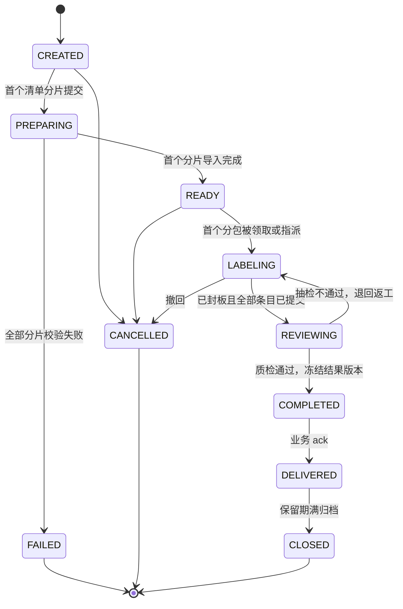

# 数据标注

> 平台 · 数据标注模块（`annotation` schema）。本文是模块总览；细节见 [Label Studio 集成与语言](labelstudio.md)、[场景模板](templates.md)、[业务系统对接](integration.md)。相关：[统一认证与身份](../auth/identity.md)、[统一权限组件](../auth/authz.md)、[对象存储路径](../../storage.md)、[定时任务与异步处理](../scheduler.md)。

## 要点

- **Label Studio 只当画布**：从社区版源码（锁定 1.23.2，Apache-2.0）构建编辑器包并嵌入标注工作台；不部署 Label Studio 服务及其数据库，工单、数据、分配、质检、结果全部由本模块实现。
- **两种标注方式**：**分配标注**——工单拆成分包，标注员从任务池领取，或由负责人 / 业务指定给某个用户；**自由标注**——用户在控制台自己建任务、上传数据、按任意顺序标注，随时追加数据，自己决定何时完成。
- **账号直接用平台用户体系**：标注员、质检员、协作者都是平台身份账号（`sub`），从本租户身份目录选人；不建 Label Studio 用户，也没有标注专用账号。
- **中文 / 英文由平台统一控制**：编辑器同时构建汉化版与英文原版，平台设置决定默认语言及是否允许用户切换，控制台、工作台、编辑器跟随同一设置。
- **工单制对接业务**：业务建单（清单 + 场景模板 + 成员 + 质检策略），平台标注、质检、冻结结果版本，事件通知业务，业务拉取结果并 `ack`；海量文件默认引用业务存储，不复制。
- **场景模板 = 编辑器 XML + 数据契约 + 字段映射 + 质检规则**：带版本，分系统 / 租户 / 应用三级，控制台可视化预览。
- **编辑器可替换**：模块只认自己的结果格式，编辑器适配集中在工作台一个组件内。

## 模块文档

| 文档 | 内容 |
|------|------|
| 本文 | 模块边界、两种标注方式、用户与权限、核心对象、状态机、一致性、分期 |
| [Label Studio 集成与语言](labelstudio.md) | 选型、源码构建、嵌入接口、汉化来源、平台级语言控制 |
| [场景模板](templates.md) | 模板组成、参数与映射、内置场景库、自定义与版本 |
| [业务系统对接](integration.md) | 页面嵌入、iframe 消息、SDK、海量数据接入、接口、事件、端到端时序 |

## 模块边界

| 由 Label Studio 编辑器负责 | 由本模块负责 |
|---|---|
| 按模板 XML 渲染画布：图像框 / 多边形 / 关键点、文本分类与实体关系、音视频分段与跟踪、文本框录入 | 工单、条目、数据导入与文件接入、预处理 |
| 加载条目数据与 predictions，输出标注 JSON | 分包、领取、指定、提交、跳过、问题件 |
| 画布内的快捷键、撤销、区域列表 | 质检、退回返工、结果版本、字段映射、导出 |
| | 场景模板、事件、权限、审计、语言设置、训练回流 |

```
业务系统 ──建单 / 查询 / 拉结果 / ack──▶ 网关 ──▶ 平台 · 标注模块（annotation schema）
   │                                                ├─ 导入、预处理、导出 → 任务调度（Worker）
   └─打开链接──▶ 标注工作台 ◀── 控制台「我的标注」    ├─ 事件 → outbox → 事件分发器 → 业务
                  └─ 嵌入 Label Studio 编辑器（中 / 英） └─ 副本、页图、导出 → MinIO annotation/
```

## 两种标注方式

| | 分配标注 `assigned` | 自由标注 `free` |
|---|---|---|
| 谁建 | 业务系统（API）、控制台标注管理员 | 任何持有「标注员」角色的控制台用户；业务也可经 API 建 |
| 数据 | 清单分片导入，封板后不再追加 | 浏览器直接上传或经 API 追加，随时可加 |
| 派发 | 按分包派发：任务池领取 + 指定用户 | 不分包，成员任意打开任意条目 |
| 并发控制 | 分包租约，同一条目同一时间只有一人 | 条目乐观锁（`rev`），保存冲突时提示刷新 |
| 质检 | 按 `qa_policy` 抽检，必经 | 可选：指定了质检员才进入质检 |
| 完成 | 全部分包质检通过自动冻结 | 创建人点「完成」后冻结（或进入质检） |
| 典型用途 | 档案室送标注、大批量训练集 | 算法人员快速标几百张样本、模板试标、评测集整理 |

### 分配标注：领取与指定

- **分包**：条目按 `package_size`（默认 50）切成分包，分包是派发单位。
- **任务池领取**：未指定处理人的分包进入任务池，标注员在工作台或「我的标注」点「领取」，系统按优先级、截止时间分配下一个分包；每人同时持有的分包数有上限（默认 2）。
- **指定用户**：三种粒度，优先级从高到低——
  1. 清单行带 `assignee`（业务指定某条目给某人），这些条目按人组成专属分包；
  2. 负责人在工单看板把分包指派给某个成员，或把多个分包批量指派；
  3. 建单时 `dispatch: assign` 并给出 `assignees` 与配比，平台按配比轮转分配全部分包。
- **租约**：领取或被指派后租约 2 小时，每次保存续约；超时未提交自动释放回任务池（指定给某人的分包释放后仍归此人，只提醒不转人）。
- **改派与撤回**：负责人可改派分包；被移除的成员手上未提交的分包释放。

```json
{ "mode": "assigned",
  "dispatch": { "type": "mixed", "assignees": [{ "sub": "u_3301", "weight": 2 }, { "sub": "u_3303", "weight": 1 }], "pool": true },
  "package_size": 50, "max_packages_per_user": 2 }
```

`dispatch.type`：`pool`（只用任务池）、`assign`（全部按配比指派）、`mixed`（按配比预指派一部分，剩余进任务池）。

### 自由标注

1. 控制台「我的标注」→「新建自由标注」：名称、场景模板（或空白模板直接写 XML）、协作者、是否需要质检。
2. 上传文件（拖入文件夹，浏览器经预签名地址直传平台 MinIO，副本模式），或填写已有清单；之后可随时追加。
3. 进入自由标注工作台：左侧条目列表（按状态、文件名筛选），中间画布，任意顺序标注，自动保存。
4. 创建人点「完成」：未指定质检员时直接冻结结果版本；指定了则进入质检。完成后可导出结果、加入训练集，或「转为分配标注」交给更多人继续。

自由标注默认 `allow_training = false`，单任务条目上限 1 万（超过请用分配标注）。

## 用户与权限

- **账号**：所有参与者都是平台身份账号，由 [统一认证与身份](../auth/identity.md) 维护；工单成员只存 `sub` 与角色，显示名、账号状态经身份目录接口实时查询。成员必须属于工单所在租户，账号停用（`user.disabled`）后自动移出未完成工单，手上的分包释放。
- **选人**：控制台建单与看板的成员选择器直接查询本租户身份账号；业务系统传入的 `sub` 即其本地用户关联的平台 `sub`。
- **登录**：工作台、看板、查看器属于内置应用 `kaifang-meta-console`，统一 SSO；从业务系统打开时静默登录。

| 角色 | 类型 | 能做什么 |
|------|------|----------|
| 标注员 | 控制台内置角色（`tenant`，权限点 `annotation:work`） | 进入控制台「我的标注」，领取任务池、创建自由标注 |
| 租户管理员 / 标注管理员 | 控制台角色（`annotation:manage`） | 管理场景模板、建分配工单、监控本租户全部工单、改派 |
| 工单成员 `annotator` / `reviewer` / `viewer` / `owner` | 工单级 | 在具体工单内标注、质检、查看、管理；从业务系统打开的工作台只看成员身份，不要求控制台角色 |

业务系统的用户只通过业务入口参与标注时，不需要被授予任何控制台角色。权限点与内置角色定义见 [统一权限组件](../auth/authz.md)。

## 核心对象

| 对象 | 表 | 说明 |
|------|----|------|
| 标注工单 | `task` | `mode`（`assigned` / `free`）、来源（应用或控制台用户）、模板版本、质检策略、状态；`external_ref`（应用 + 批次号）唯一 |
| 数据集版本 | `dataset_version` | 工单的数据快照：引用模式记录文件引用与哈希，副本模式记录平台路径；自由标注每次追加生成新版本 |
| 标注条目 | `item` | `item_key` 在工单内唯一；`data`、`predictions`、状态、`rev`、所属分包 |
| 分包 | `package` | 分配标注的派发单位：`assignee`、`lease_until`、状态 |
| 标注记录 | `annotation` | 编辑器输出的标注 JSON，按条目、提交人、轮次保存；草稿单独标记 |
| 质检记录 | `review` | 抽检结论、退回原因、逐区域意见 |
| 结果版本 | `result_version` | 冻结的一版结果（字段映射后）；返工后再通过生成 v2 |
| 工单成员 | `task_member` | `sub` + 角色（`owner` / `annotator` / `reviewer` / `viewer`） |
| 场景模板 | `template` / `template_version` | 见 [场景模板](templates.md) |
| 清单分片 | `manifest_part` | 每个分片的导入状态与逐行错误 |

所有表带 `tenant_id`，按 [网关与鉴权](../../gateway.md) 的轻租户规则隔离；`annotation`、`review` 按月分区。

## 状态机

分配标注：



自由标注：`CREATED → LABELING ⇄ REVIEWING（可选）→ COMPLETED → CLOSED`，`LABELING` 期间可追加数据；`COMPLETED` 后重新打开会生成新结果版本。控制台建的工单没有业务 `ack`，`COMPLETED` 即终态前一步。

条目状态：`PENDING → LABELING → LABELED → (REJECTED → LABELED) → ACCEPTED`，以及 `FLAGGED`（问题件）、`SKIPPED`。自由标注没有 `LABELING`（不领取）。

## 一致性与边界

- **只读锁在业务侧**：送标注时锁定，`DELIVERED`、`CANCELLED`、`FAILED` 时解锁；锁带超时（默认 deadline + 3 天），超时进入业务待办而非自动解锁。
- **幂等**：建单「应用 + 批次号」；条目「工单 + `item_key`」；回写「批次号 + 档号 + 结果版本」。
- **引用模式的不可变**：业务承诺标注期间原件不变；哈希不一致的条目转 `FLAGGED`，不静默使用新文件。
- **保留期**：清单分片建单后 7 天；副本、页图、导出在业务 `ack`（控制台工单为 `COMPLETED`）后 90 天；标注记录、结果版本与审计按租户配置（默认 3 年）。路径见 [对象存储路径](../../storage.md)。
- **训练回流**：仅当工单 `allow_training = true`、模板允许且条目 `ACCEPTED` 时进入训练数据集版本；涉密模板禁止回流。

## 分期

| 期 | 内容 | 验收 |
|----|------|------|
| 1 POC | 构建 1.23.2 中 / 英两套编辑器包；`AnnotationCanvas` 跑通著录校对、图像框、视频分段三个模板；平台语言设置 | 汉化覆盖率、多页图像与视频按区间加载、切换语言生效 |
| 2 主流程 | 分配标注（任务池 + 指定）、清单分片、引用模式、质检、结果版本、事件、SDK；档案室送标注全链路 | 档案室六步流程端到端演示 |
| 3 自由标注与模板 | 自由标注、「我的标注」、模板编辑器与内置场景库、工单看板与结果查看器、预处理流水线 | 用户从上传到导出 10 分钟内完成 |
| 4 规模与回流 | `partial` 交付、结果导出、训练数据集版本、预标注采纳率 | 10 万条目工单不卡顿；训练集可被引用 |
