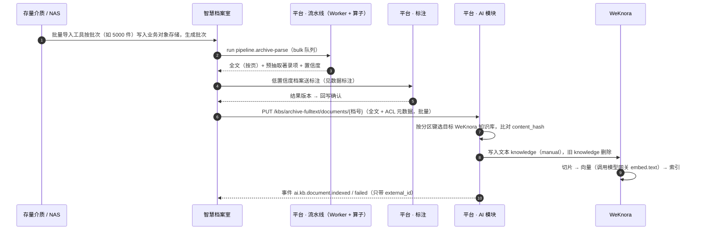

# 知识库与 Agent 引擎（WeKnora）

> 平台 · AI 模块的提供方，独立进程 `kaifang-meta-weknora` + `kaifang-meta-docreader`。相关：[知识库与 Agent 版本](knowledge-agent.md)、[能力目录](catalog.md)、[数据标注](../annotation.md)、[对象存储路径](../../storage.md)、[Agent 桌面端](../../harness.md)。

## 要点

- **WeKnora 是引擎，不是入口**：知识库解析、切片、检索、ReAct Agent 由开源 WeKnora（腾讯，MIT）承担；目录、授权、ACL 过滤、版本、计量、审计仍在 AI 模块。业务系统、浏览器、桌面端只调用 `/kaifang-meta/platform/ai/v1/*`（桌面端只用其中的知识库 MCP），WeKnora 不经网关对外暴露。
- **不新增基础设施**：WeKnora 复用平台 PostgreSQL（独立数据库 + pgvector）、Redis（独立 DB 号）、MinIO（`ai` 业务目录）；Neo4j、Elasticsearch、Milvus、Langfuse 等可选组件一律不启用。
- **模型统一走模型网关**：WeKnora 内配置的对话、向量、重排模型都指向平台模型网关（OpenAI 兼容），计量、配额、按密级路由本地模型不被绕过。
- **界面自建，不嵌入 WeKnora 网页**：控制台知识库 / Agent 管理页、业务内嵌问答面板、平台托管的网页版 Agent 均为 nova-admin 风格自建页面，调用 AI 模块的 SSE 接口；WeKnora 自带 Web UI 只在运维内网用于调试解析与检索效果。
- **海量档案不让 WeKnora 重复 OCR**：原件留在智慧档案室对象存储；平台流水线解析出的全文（按页 Markdown）+ ACL 元数据以文本方式写入 WeKnora，只有制度规范等小批量文件才直接上传让 docreader 解析。
- **权限靠分区 + 后置校验**：WeKnora 不理解业务权限，强制过滤字段（全宗、密级）映射为 WeKnora 知识库分区，检索与 Agent 会话只放行有权分区，返回结果再按元数据二次校验。
- **Label Studio 只做标注画布**：沿用 [数据标注](../annotation.md) 的嵌入编辑器方案；标注回写确认后的档案才进入全文知识库，问答评测集也用标注工单产出。

## 定位与部署

```
业务后端 / 网页版 Agent / 桌面端
        │  /kaifang-meta/platform/ai/v1/*（网关，Service Token 或用户 Token）
        ▼
平台 · AI 模块（ai schema：知识库定义、版本、分区映射、文档映射、Agent 快照、会话审计）
        │  内网 HTTP，X-API-Key（每租户一把，加密存储）
        ▼
kaifang-meta-weknora × N ──gRPC──▶ kaifang-meta-docreader × N
        │                                    
        ├─ PostgreSQL：库 kaifang-meta-weknora（pgvector + pg_search）
        ├─ Redis：独立 DB 号（解析队列）
        ├─ MinIO：kaifang-meta-platform/ai/…
        └─ 模型调用 ─▶ 平台模型网关（llm.chat / embed.text / rerank）
```

| 项 | 约定 |
|----|------|
| 进程 | `kaifang-meta-weknora`（WeKnora 后端，Go）、`kaifang-meta-docreader`（解析，Python），镜像由官方镜像固定版本重打标签，与 `kaifang-meta-operator` 同属独立进程 |
| 版本 | 锁定 WeKnora 小版本（起步 v0.8.x），升级先在预发跑评测集回归 |
| 网络 | 只在平台内网可达；AI 模块是唯一调用方；Web UI 端口只对运维网段开放 |
| 数据库 | 同一 PostgreSQL 集群上的独立数据库 `kaifang-meta-weknora`，由 WeKnora 自带迁移管理；AI 模块不读写其表，只走 API |
| 关键词检索 | WeKnora 的 PostgreSQL 混合检索依赖 `pg_search`（ParadeDB）扩展，平台 PostgreSQL 镜像需同时带 pgvector 与 pg_search |
| 多租户 | 平台租户 `tid` ↔ WeKnora 租户一一对应；应用空间体现在知识库命名 `{space}.{kb}` 上，不映射 WeKnora 工作区成员 |
| 用户 | 最终用户**不在 WeKnora 建账号**，WeKnora 的 OIDC / 工作区角色不启用；用户身份由 AI 模块记录在会话审计中 |
| 关闭项 | Neo4j（GraphRAG）、Elasticsearch / Milvus / Qdrant、Langfuse、内置网页搜索（默认关，按 Agent 显式开启且仅限非涉密）、IM 渠道、嵌入挂件 |

## 平台对象与 WeKnora 对象映射

| 平台（AI 模块，`ai` schema） | WeKnora | 说明 |
|-----------------------------|---------|------|
| 知识库定义 `kb.archive-fulltext` | — | 切片配置、向量模型、强制过滤字段、分区键 |
| 知识库版本 `v3` | 一组 WeKnora 知识库（每分区一个） | 命名 `{space}.{kb}@v3/{分区值}`，如 `space.archive-room.archive-fulltext@v3/J001-内部` |
| `prod` 别名 | — | 指向某个版本；回滚 = 切别名，WeKnora 侧不动 |
| 知识库文档 `external_id` | knowledge（`knowledge_id`） | 映射表 `kb_document(kb_version, partition, external_id, knowledge_id, content_hash, status)` |
| Agent 版本快照 | 自定义 Agent | 发布时按快照生成 WeKnora Agent 配置（提示词、模型、知识库 ID、MCP 工具），快照不可变 |
| 会话 | session | AI 模块保存 `sub`、应用、过滤条件、引用来源，用于审计；WeKnora 会话只作运行态 |
| 知识库 MCP `/ai/v1/mcp` | 知识库 MCP 服务（Streamable HTTP） | AI 模块代理，只透传已授权知识库的检索工具；供桌面端 RAG skill 等外部 MCP 客户端使用 |
| Agent 工具 `tool.archive-search` | MCP 服务 | 业务 OpenAPI 由平台以 MCP 暴露，WeKnora 作为 MCP 客户端调用，调用经平台代表用户 |

两类知识库的版本语义不同，见 [知识库与 Agent 版本](knowledge-agent.md)：

| 类型 | 示例 | 文档变化 | 新版本触发 |
|------|------|----------|-----------|
| 快照库 | 制度规范 `kb.archive-spec`、政策法规 `kb.policy` | 在草稿版本中增删，发布后不可变 | 每次发布 |
| 实时库 | 馆藏全文 `kb.archive-fulltext` | 业务推送 upsert / delete 直接作用于当前 `prod` 版本 | 切片配置、向量模型变更时全量重建新版本，建完评测通过后切别名 |

## 海量档案：导入、存储、入库

### 存在哪

| 数据 | 位置 | 说明 |
|------|------|------|
| 原件（PDF / OFD / 图像） | 智慧档案室自己的对象存储 `archive-files/…` | 不进平台桶；问答引用需要预览原件时，前端按 `external_id` 向业务后端要预签名 URL |
| 著录项、全文、著录版本 | 智慧档案室业务库 | 以业务库为准 |
| 解析中间结果 | `capability/{tenant}/kaifang-meta-archive-room/runs/{run_id}/…` | 30 天，见 [对象存储路径](../../storage.md) |
| 知识库文本副本 | `ai/{tenant}/{space}/kb/{kb}/docs/{external_id}/…` | WeKnora 写入的 Markdown 文本（全文库不存原件副本） |
| 切片、向量、关键词索引 | PostgreSQL 库 `kaifang-meta-weknora` | 按知识库（即分区）组织 |
| 映射、版本、会话审计 | PostgreSQL `ai` schema | AI 模块自有 |

容量估算（全文库，1024 维）：100 万件 × 平均 10 页 × 每页约 2 个切片 ≈ 2000 万向量，float32 约 80 GB + HNSW 索引。超过千万级时按 [总体架构](../../overview.md) 的约定为该租户独立部署平台，或启用 `halfvec` 半精度存储；不引入独立向量库。

### 怎么导



- **只入已确认的档案**：全文库只接收回写确认（或无需标注）的档案；标注期间档案只读，不推送。
- **文本入库为主**：`pipeline.archive-parse` 已做了文本层提取 / OCR，入库时提交文本，WeKnora 不再解析原件，避免百万页重复 OCR；文件上传入库只用于制度规范等小库。
- **批量与限速**：业务按批调用文档接口（每批 ≤ 500 条），AI 模块写 `bulk` 队列任务，由 Worker 按租户并发上限逐条提交 WeKnora；真正瓶颈是向量模型吞吐，由模型网关配额控制，存量导入安排在夜间窗口。
- **幂等**：`external_id = 档号`，内容哈希不变则跳过；著录版本更新、密级变更即 upsert（先写新 knowledge 再删旧，期间检索不断档），业务删除即 delete。
- **补偿**：业务按批次查询 `GET /kbs/{kb}/documents?batch_no=&status=failed` 重推；全量对账按 `external_id + content_hash` 分页比对。

## 权限与数据范围

沿用 [能力目录](catalog.md) 的「入库带 ACL 元数据、调用时由业务传过滤条件、可声明强制过滤字段」，落到 WeKnora：

| 层 | 做法 |
|----|------|
| 分区（硬隔离） | 知识库定义声明分区键（默认 `fonds × secret_level`），每个分区值一个 WeKnora 知识库；业务传来的过滤条件先换算为可访问分区，检索与 Agent 会话只携带这些 `knowledge_base_ids` |
| 细粒度（组织、可见范围） | 以元数据 / 标签写入 knowledge；WeKnora 检索若支持按标签过滤则下推，否则只靠后置校验 |
| 后置校验 | AI 模块在返回检索结果、Agent 引用前，按文档映射表元数据再校验一次，不符合的片段丢弃并记审计 |
| 模型路由 | 分区密级高于阈值时，该会话只允许本地模型；Agent 的网页搜索、外部 MCP 工具自动禁用 |

WeKnora API Key 只在 AI 模块内使用，每租户一把，权限范围限定为本租户；不发给业务系统和浏览器。

## 网页版 Agent 与界面

**结论：自建界面，不嵌入 WeKnora 网页。** 理由：WeKnora Web UI 有自己的登录、工作区与角色，嵌入就要给用户开 WeKnora 账号并复制权限；浏览器直连会绕过 ACL 分区、计量和审计；它暴露全部知识库与模型设置；风格也与 nova-admin 不一致。嵌入挂件（Embed Widget）同样直连 WeKnora，不采用。

| 界面 | 位置 | 调用方式 | 说明 |
|------|------|----------|------|
| 知识库 / Agent 管理 | 平台控制台「能力」分组（已有原型 `#kb`、`#agents`） | 用户 Token → AI 模块 | 文档列表、解析状态、检索测试、版本发布、评测；不暴露 WeKnora 概念 |
| 业务内嵌问答面板 | `kaifang-meta-shell` 组件，嵌入智慧档案室等 | 业务后端代理（注入过滤条件，代表用户） | 适用于有强制过滤字段的知识库 / Agent |
| 桌面端 RAG skill（后续） | `kaifang-harness` 本机 | 用户 Token → AI 模块知识库 MCP | 桌面端 Agent 在本机运行，不使用 WeKnora Agent，见 [Agent 桌面端](../../harness.md) |
| 网页版 Agent | 平台托管页面 `/kaifang-meta/console/agent/chat/{agent}` | 用户 Token（SSO 静默登录）→ AI 模块 | 只开放未声明强制过滤字段的 Agent；业务系统以链接打开，与标注工作台同一模式 |
| 运维调试 | WeKnora 原生 Web UI，运维网段 | WeKnora 管理员账号 | 只看解析、切片、召回效果，不做配置变更（配置以 AI 模块为准） |

**流式协议**：AI 模块把 WeKnora 的 SSE 事件（思考、工具调用、检索引用、回答增量）归一为平台事件，前端组件只认平台格式，更换引擎时前端不改。

```http
POST /kaifang-meta/platform/ai/v1/agents/agent.archive-qa/chat
Accept: text/event-stream
```

```json
{ "session_id": "s_7f3a…", "query": "2019 年 J001 全宗有哪些涉及征地的文书？",
  "filters": { "fonds": ["J001"], "secret_level": ["公开", "内部"] } }
```

```text
event: step        data: {"type":"tool","name":"kb.search","status":"running"}
event: citation    data: {"external_id":"J001-2019-WS30-0102","page":3,"score":0.82}
event: delta       data: {"text":"共检索到 4 件…"}
event: done        data: {"usage":{"prompt_tokens":2310,"completion_tokens":412}}
```

## 与 Label Studio（数据标注）的关系

| 场景 | 做法 |
|------|------|
| 著录项校对 | 已有流程，见 [数据标注](../annotation.md)；回写确认是全文入库的前置条件 |
| 问答评测集 | 控制台对知识库 / Agent 建标注工单，模板为「问题 + 期望引用档号 + 参考答案」，结果版本即评测集版本，用于发布前回归 |
| 回答质量反馈 | 用户点「不满意」的会话按天抽样生成标注工单，质检通过后进入评测集，可用于调整提示词或切片配置 |

Label Studio 仍只嵌入编辑器组件，不部署其服务；WeKnora 与标注模块之间不直接调用，都经 AI 模块 / 标注模块接口。

## 实施顺序

1. **PoC（两周）**：部署 WeKnora（PostgreSQL + MinIO 模式），模型指向模型网关；用 1 万件档案文本验证分区检索、标签过滤是否可下推、SSE 事件格式、MinIO 路径前缀是否可配到 `ai/`。
2. **AI 模块适配层**：知识库 / 文档 / 检索接口、分区映射、文档映射表、后置校验、SSE 归一。
3. **控制台页面**：知识库、Agent 管理页对接真实接口。
4. **存量导入**：按全宗分批夜间入库，先公开 / 内部密级。
5. **网页版 Agent 与业务问答面板**、评测集标注模板。

## 待确认

- WeKnora 的 MinIO 存储能否配置路径前缀；若只能指定桶，需要为其单独建桶（违反 [对象存储路径](../../storage.md) 的单桶约定）或改用文本入库后不保留文件。
- 平台 PostgreSQL 镜像改为带 `pg_search` 的发行版（ParadeDB）是否可接受；不接受则只用向量检索，关键词召回下降。
- WeKnora 检索接口是否支持按知识元数据过滤；不支持时细粒度权限只靠后置校验，召回数量需放大。
