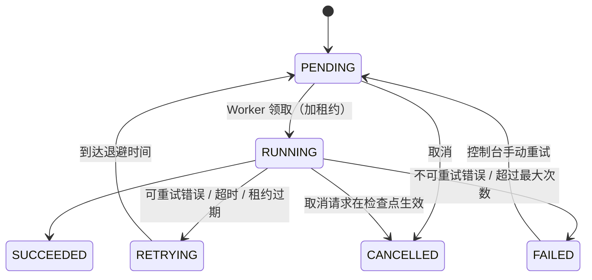
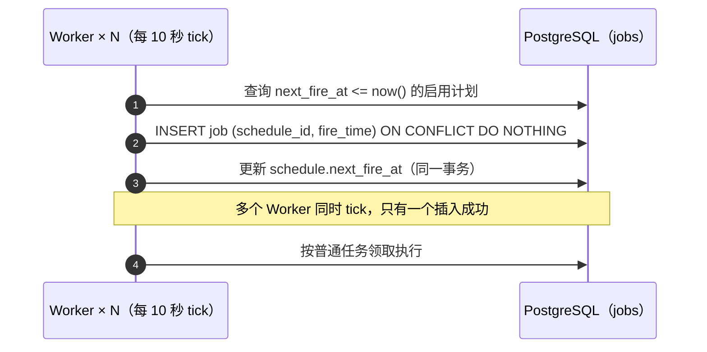
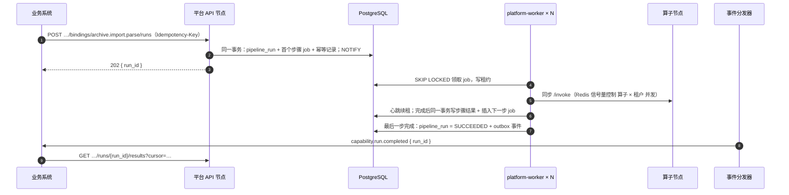

# 定时任务与异步处理

> 平台 · 任务调度模块 + 独立进程 `kaifang-meta-platform-worker × N`（与平台同一代码库，不同启动入口）。相关：[多节点部署](../deployment.md)、[业务与平台通信](../communication.md)、[能力点](capability/binding.md)。

## 要点

- **不引入 Temporal / Celery / 消息队列**：任务、定时计划、流水线状态全部存 PostgreSQL（`jobs` schema）；Worker 用 `SELECT … FOR UPDATE SKIP LOCKED` 竞争领取，多节点天然不重复。
- **API 节点只入队，Worker 执行**：平台 API 在业务事务内写入任务并立即返回 `202`；耗时操作一律不在请求线程里做。
- **定时任务也是任务**：定时计划到点时插入一条普通任务，`(schedule_id, fire_time)` 唯一约束保证多节点只触发一次，不需要选主。
- **至少一次执行**：租约 + 心跳，Worker 崩溃后由其他 Worker 接手；每个任务按业务键幂等。
- **按逻辑队列隔离**：长任务、短任务、系统任务分队列，按队列配置 Worker 并发，再按租户限并发，避免互相饿死。
- **完成即发事件**：任务结束写 outbox，由事件分发器通知业务系统；业务同时可轮询状态，见 [业务与平台通信](../communication.md)。
- 实现优先用成熟的 PostgreSQL 任务库（Java：db-scheduler；Python：procrastinate）承载领取、租约与重试，平台只补流水线、队列配额与控制台。

## 任务分类

| 类型 | 触发 | 示例 | 队列 |
|------|------|------|------|
| 定时任务 | cron 计划 | 采集同步（CDC / FTP 每日 02:00）、APISIX 配置对账（5 分钟）、计量汇总（1 分钟）、过期快照清理（每日） | `system` / `ingest` |
| 异步调用 | 业务调用平台 API | 能力异步调用 `runs`、标注工单准备、知识库文档入库 | `default` |
| 流水线 | 异步调用或定时任务启动 | `pipeline.archive-parse@3`：文本层检测 → `pdf.text` / OCR → `extract.doc` | `pipeline` |
| 长任务 | 控制台操作 | 知识库版本构建、批量重跑算子、训练数据集导出 | `bulk` |
| 事件派生 | 平台内部事件 | 账号停用后清理会话、绑定变更后预热缓存 | `system` |

## 数据模型

| 表 | 主要字段 |
|----|---------|
| `schedule` | cron、时区（默认 Asia/Shanghai）、任务类型与参数、错过策略、并发策略、启停、下次触发时间 |
| `job` | 类型、队列、优先级、参数、租户、状态、`run_at`、`attempt` / `max_attempts`、`timeout`、`locked_by` / `locked_until`、`cancel_requested`、幂等键（唯一约束）、`parent_id`、`trace_id` |
| `pipeline_run` | 流水线定义与版本、输入引用、当前步骤、状态、结果引用 |
| `pipeline_step` | 步骤序号、状态、输入输出引用（大结果存 MinIO，只记路径）、`pending_children`（扇出计数） |

`job` 与 `pipeline_*` 按月分区，已结束的记录保留 30 天，失败记录保留 180 天。

## 任务状态

## 定时任务

| 策略 | 选项 | 默认 |
|------|------|------|
| 错过策略（Worker 全部停机期间错过的触发） | 只补最近一次 / 全部补 / 跳过 | 只补最近一次 |
| 并发策略（上一次还没结束） | 跳过本次 / 排队 / 并行 | 跳过本次 |
| 超时 | 按计划配置 | 1 小时 |

定时计划在控制台「任务调度 → 定时计划」维护，修改走审计日志；采集连接器的同步频率保存在采集模块，由采集模块调用任务调度接口创建 / 更新计划，不跨模块写表。

## 异步处理

- **扇出 / 汇聚**：批次内每个文件一个子任务（`parent_id` 指向步骤），`pending_children` 在子任务完成的同一事务内减一，减到 0 时插入下一步任务。一个 2,000 页的批次因此可被多台 Worker 并行处理，单个文件失败只重试该文件。
- **进度**：`GET …/runs/{run_id}` 返回步骤状态与子任务完成数；`annotation.task.progress` 类进度事件限频发送。
- **取消**：`POST …/runs/{run_id}/cancel` 置 `cancel_requested`，Worker 在心跳和步骤边界检查后停止；已产生的结果保留，状态为 `CANCELLED`。

## 队列与并发

| 队列 | 用途 | 每个 Worker 并发 | 说明 |
|------|------|-----------------|------|
| `default` | 短异步调用 | 16 | 期望秒级完成 |
| `pipeline` | 流水线步骤 | 8 | 受算子并发信号量二次限制 |
| `ingest` | 采集同步 | 4 | 外部系统慢，独立隔离 |
| `bulk` | 知识库构建、批量重跑 | 2 | 低优先级，空闲时执行 |
| `system` | 平台内部定时任务 | 2 | 对账、清理、汇总 |

- Worker 启动参数决定订阅哪些队列（如 GPU 附近的主机只跑 `pipeline`），通过增减 Worker 容器扩缩。
- **租户公平**：Redis 计数限制每个租户在 `pipeline` / `bulk` 上的并发（默认 4），一个租户的大批次不会占满全部 Worker。
- 同一队列内按 `priority` 再按 `run_at` 领取。

## 重试、超时与幂等

- **错误分类**：网络错误、`429`、`503`、超时、租约过期 → 可重试；契约错误、参数校验失败、`4xx` → 不重试直接 `FAILED`。
- **退避**：1 分钟 / 5 分钟 / 30 分钟（默认 `max_attempts = 3`，可按任务类型配置），带随机抖动。
- **超时**：每个任务有 `timeout`，Worker 超时即中止并按可重试处理；长任务每 30 秒心跳续租，租约默认 2 分钟。
- **幂等**：任务入队按幂等键去重；任务内部的副作用（写结果、调用算子、写 MinIO）以「任务 ID + 步骤 + 条目键」为键，重复执行覆盖同一结果而不是追加。
- **失败处理**：`FAILED` 任务在控制台「任务调度」列出，可查看错误、重试、跳过该条目继续流水线；连续失败按任务类型告警。

## 业务系统侧

业务系统不接入平台调度，自己的定时与异步任务基于自身数据库实现，SDK 提供两个最小组件：

- `@KmScheduled`（Java）/ `km.scheduled`（Python）：基于 PostgreSQL advisory lock，多节点只有一个执行；用于补偿轮询、本地清理。
- 事件接收的 `km_event_inbox`：去重后的事件处理与业务写在同一事务，见 [多节点部署](../deployment.md)。

## 可观测

- 指标：各队列待处理数、等待时长 P95、执行时长、失败率、租约过期次数、各租户并发占用。
- 每个任务记录 `trace_id`，可从业务请求一路追到 Worker 与算子调用。
- 控制台「任务调度」页：运行记录、定时计划、Worker 列表（在线节点、订阅队列、当前任务数）。
